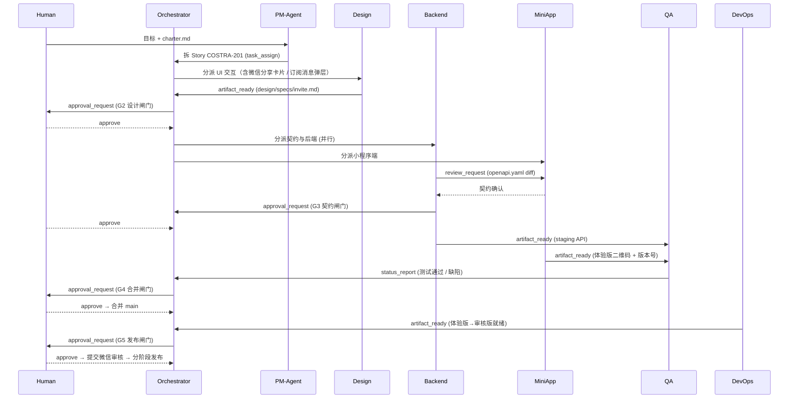
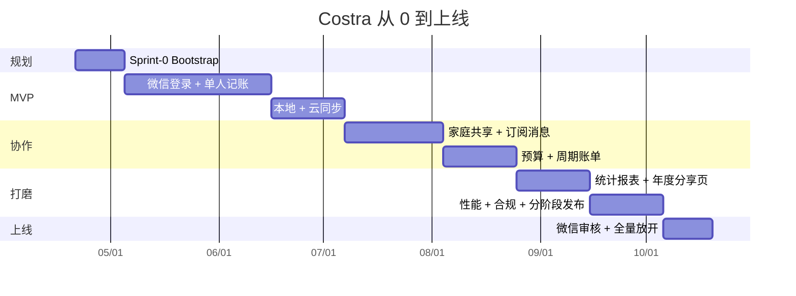

# Costra Blueprint · 从 0 到上线

> **cost + track** —— 面向家庭的云端共享记账 **微信小程序**
> 本文件是项目的**权威蓝图**：
> 汇总前期所有讨论结论，统一说明 ①整体架构 ②多 Agent 协作过程 ③观察与干预方式，
> 并给出 `h:/Costra` 仓库中各目录与文件的落地映射。
>
> **版本**：v2.0（2026-04-21，平台从 iOS 原生改为微信小程序，见 [`ADR-0003`](.team/decisions/ADR-0003-platform-change-to-miniprogram.md) 与 [`docs/PLATFORM-MIGRATION.md`](docs/PLATFORM-MIGRATION.md)）

目录
1. 项目定位与范围
2. 整体架构（宏观视图）
3. 多 Agent 研发组织
4. Agent 协作过程（从 0 到上线）
5. 观察体系（看得见）
6. 干预体系（管得住）
7. 纠错与灾难恢复（救得回）
8. 仓库结构映射 & 文件索引
9. 启动与日常节奏
10. 路线图（6~9 个月）

---

## 1. 项目定位与范围

- **名称**：Costra（cost + track）
- **平台**：**微信小程序**（主阵地），后续可扩展 H5 分享页、微信小游戏轻量入口；不再做 iOS / Android 原生端
- **核心功能**：家庭多人共享记账、云端数据、弱网可用、实时同步、微信生态原生分享
- **MVP 必做**：微信登录 / 单人记账 / 本地缓存 + 云同步 / 家庭共享（邀请码 + 微信群分享卡片） / 实时推送（订阅消息） / 合规
- **MVP 不做**：AI 语音、OCR、端到端加密账本（二期再谈）、原生 App
- **成功标准**：微信小程序审核一次过、SLA ≥99.9%、P0 缺陷清零、首屏可交互 ≤ 2s、主包 ≤ 2MB

详见 [`docs/charter.md`](docs/charter.md) 与 [`.team/backlog.json`](.team/backlog.json)。

---

## 2. 整体架构（宏观视图）

```
┌─────────────────────────────────────────────────────────────┐
│          微信小程序客户端（原生 MINA + TypeScript）           │
│  Page/Component → Store(MobX-miniprogram) → Service → API   │
│          ↕ 本地缓存（wx.storage + 自建 IndexedLike 层）       │
│          ↕ SyncEngine（增量拉取 / 版本号 / 冲突解决）          │
│          ↕ 订阅消息 / 模板消息（替代 APNs 推送）               │
└────────────┬────────────────────────────────────────────────┘
             │  HTTPS（微信白名单域名）· WebSocket（wx.connectSocket）
┌────────────▼────────────────────────────────────────────────┐
│           API 网关（鉴权 / 限流 / 灰度 / WAF / 防刷）          │
│           + 微信登录凭证换 session_key / openid                │
└────────────┬────────────────────────────────────────────────┘
             ▼
 ┌────────┬────────┬────────┬─────────┬──────────┐
 │ 用户    │ 账本   │ 流水   │ 统计    │ 通知      │  微服务（Go / Gin / gRPC）
 └────┬───┴────┬───┴────┬───┴────┬────┴────┬─────┘
      ▼        ▼        ▼        ▼         ▼
   MySQL   Redis   MongoDB  对象存储   Kafka → ClickHouse(OLAP)
  (事务)  (缓存)  (审计日志)  (COS+CDN)  (异步解耦)
```

**关键技术决策**（见 [`.team/decisions/ADR-0002-tech-stack.md`](.team/decisions/ADR-0002-tech-stack.md)）：

| 层 | 选型 |
|---|---|
| 客户端 | 微信小程序原生框架（MINA） + TypeScript + Skyline 渲染引擎（可选） |
| 状态管理 | MobX-miniprogram / 自研轻量 Store |
| 本地存储 | `wx.setStorageSync` + 结构化缓存层（版本化、容量监控） |
| 构建 | 微信开发者工具 + miniprogram-ci（命令行上传） |
| 后端 | Go 1.22+ / Gin / gRPC / MySQL 8.0 / Redis 7 |
| 金额 | `DECIMAL(18,4)` + 客户端 `decimal.js` / Go `decimal.Decimal`（**严禁 float**） |
| 消息 | Kafka |
| 对象存储 | 腾讯云 COS + CDN（小程序需备案白名单） |
| 推送 | 微信**订阅消息**（用户一次订阅 N 次下发）+ 客服消息 |
| CI/CD | GitHub Actions + miniprogram-ci |
| 部署 | Docker + K8s + Helm + Terraform |
| 监控 | Prometheus + Grafana + AlertManager + APM + 微信小程序后台性能监控 |

**关键设计要点**：
- **离线可用 + 增量同步**：每条记录带 `local_id / server_id / version / updated_at / sync_state`；冲突以"服务器权威 + 保留副本 + 敏感字段弹窗"三级策略处理。受限于 `wx.storage` 单 key 1MB / 总 10MB，本地缓存层做 LRU + 分片。
- **安全红线**：HTTPS + 合法域名白名单；密码 bcrypt；Token 存 `wx.storage` 并走 `session` 封套（不可落地明文）；所有查询强制 `family_id` 权限过滤；审计日志上 MongoDB。
- **合规清单**：微信小程序《用户隐私保护指引》、`privacy_*` 接口合规声明、类目备案（金融->账本类需配合"家庭记账工具"非金融定位说明）、家庭成员数据共享知情同意、ICP 备案与小程序服务器域名白名单。
- **平台约束内化**：主包 ≤ 2MB，超出走分包；所有网络请求域名必须在微信公众平台后台配置；`request / uploadFile / downloadFile / socket` 域名分别配置。

---

## 3. 多 Agent 研发组织

我们把研发团队建模成 **1 个 Orchestrator + 6 个专业 Agent + 1 个 Human**：

```
                         ┌─────────────────────────┐
                         │      Human（你）         │
                         │   闸门批准 / 干预 / 仲裁   │
                         └───────────┬─────────────┘
                                     │
                         ┌───────────▼─────────────┐
                         │      Orchestrator        │
                         │ 分派 · 追踪 · 闸门 · 归档  │
                         └───────────┬─────────────┘
                                     │ 消息总线（JSONL）
   ┌──────────┬──────────┬──────────┼──────────┬──────────┐
   ▼          ▼          ▼          ▼          ▼          ▼
 ┌─────┐  ┌──────┐  ┌────────┐ ┌──────┐   ┌──────┐   ┌─────┐
 │ PM  │  │Design│  │MiniApp │ │Backend│  │DevOps│   │ QA  │
 └─────┘  └──────┘  └────────┘ └──────┘   └──────┘   └─────┘
     └────────┴─────────┬──────┴────────┴─────────┘
                        ▼
              共享制品库（h:/Costra 全仓）
  docs/ · design/ · api/ · miniapp/ · server/ · infra/ · qa/ · .team/
```

Agent 边界与权限（详见 [`.team/agents/COMMON-CONTRACT.md`](.team/agents/COMMON-CONTRACT.md)）：

| Agent | 可写目录 | 核心职责 | 关键产物 |
|---|---|---|---|
| Orchestrator | `.team/`（消息/看板/daily） | 分派 + 闸门 + 归档 | `board.md` / `daily/*.md` / 消息投递 |
| PM-Agent | `docs/`、`.team/board.md` 等 | 需求 / 排期 / 风险 | `PRD.md` / `weekly/*.md` / 任务卡 |
| Design-Agent | `design/` | IA / UI / 设计系统（对齐 **WeUI / 小程序设计指南**） | `specs/*.md` / `design_system.json` |
| **MiniApp-Agent** | `miniapp/` | **小程序客户端实现** | **小程序代码 / 单测 / 体验版二维码** |
| Backend-Agent | `server/` `api/` | 服务端 + 契约（含 wx.login 流程） | `openapi.yaml` / Go 代码 / 迁移 |
| DevOps-Agent | `infra/` `.github/workflows/` | 环境 / CI-CD / 监控 / 域名备案 | Terraform / Helm / 流水线 / miniprogram-ci 发布 |
| QA-Agent | `qa/` | 用例 / 自动化 / 回归 | 用例 / 脚本（`miniprogram-automator`） / 发布报告（一票否决） |

7 份完整系统提示词已落地：`.team/agents/00-orchestrator.md` ~ `06-qa-agent.md`（其中 `03-miniapp-agent.md` 替代原 `03-ios-agent.md`）。

---

## 4. Agent 协作过程（从 0 到上线）

### 4.1 一件事的完整旅程（以"家庭邀请码 COSTRA-201"为例）



### 4.2 从 0 到上线的八步走

| # | 阶段 | 主要 Agent | 闸门 | 产物 |
|---|---|---|---|---|
| 0 | 立项 | Human | — | `docs/charter.md` |
| 1 | 需求与规划 | PM | **G1** | `docs/PRD.md` v0.1 + backlog + roadmap |
| 2 | 设计 | Design | **G2** | `design/specs/*` + 设计系统（对齐 WeUI） |
| 3 | 契约与基础设施 | Backend + DevOps | **G3** | `api/openapi.yaml` + DB Schema + Docker Compose + 微信域名白名单 |
| 4 | 并行开发 | MiniApp + Backend | — | 代码 + 单测 |
| 5 | CI/CD + 联调 | DevOps + QA | **G4** | 流水线 + staging + 回归 + 体验版上传 |
| 6 | 测试与灰度 | QA + DevOps | **G5** | 签字单 + 体验版 → 审核版 → 分阶段发布（1%→10%→50%→100%） |
| 7 | 上线与运营 | 全员 | — | APM + 小程序后台数据 + 周报 + 复盘 |

### 4.3 Agent 之间"怎么说话"

所有消息是结构化 JSON（Schema: [`.team/schemas/message.schema.json`](.team/schemas/message.schema.json)），追加到 `.team/messages/YYYY-MM-DD.jsonl`。常见类型：

- `task_assign` PM/Orchestrator → 某 Agent
- `status_report` Agent → Orchestrator
- `artifact_ready` Agent → 下游 Agent
- `review_request` 跨 Agent 评审
- `approval_request` / `approval_response` 闸门
- `blocker` 阻塞升级
- `intervention` Orchestrator → Agent（人工干预的转译）
- `heartbeat` 存活心跳

**契约优先原则**：任何跨 Agent 协作必先出契约（PRD / 设计规范 / OpenAPI / 测试用例），契约先入仓再写实现。

---

## 5. 观察体系（看得见）

### 5.1 三层视图

```
┌─────────────────────────────────────────────────┐
│ L1 战略（每周）: weekly/W-x.md · metrics.json · risks.md │
├─────────────────────────────────────────────────┤
│ L2 战术（每日）: board.md · daily/YYYY-MM-DD.md · dashboard.html │
├─────────────────────────────────────────────────┤
│ L3 执行（按需）: messages/*.jsonl · tool_calls/*.jsonl · 各 Agent 产物 │
└─────────────────────────────────────────────────┘
```

### 5.2 强制可观察产物

| 文件 | 谁写 | 频率 |
|---|---|---|
| [`.team/board.md`](.team/board.md) | Orchestrator（基于 PM 指令） | 状态变更即时 |
| [`.team/daily/YYYY-MM-DD.md`](.team/daily/TEMPLATE.md) | Orchestrator | 每日 |
| [`.team/messages/*.jsonl`](.team/messages/2026-04-20.jsonl) | 所有 Agent | 实时追加 |
| [`.team/tool_calls/*.jsonl`](.team/tool_calls/README.md) | 所有写类 Agent | 每次工具调用 |
| [`.team/metrics.json`](.team/metrics.json) | Orchestrator | 每日 |
| [`.team/risks.md`](.team/risks.md) | PM-Agent | 随时 |
| [`.team/decisions/ADR-*.md`](.team/decisions/) | 争议方共同提交 | 随时 |

### 5.3 本地可视化看板

[`.team/dashboard.html`](.team/dashboard.html) 是一个**零依赖**的 HTML 看板：
- 读取 `.team/STATE / board.md / metrics.json / risks.md / daily/*.md / messages/*.jsonl / tool_calls/*.jsonl`
- 每 15 秒自动刷新
- 启动：
  ```powershell
  cd h:/Costra
  python -m http.server 8787
  # 浏览器打开 http://localhost:8787/.team/dashboard.html
  ```

---

## 6. 干预体系（管得住）

### 6.1 五个闸门（Human-in-the-Loop Gates）

| 闸门 | 由谁触发 | 动作 |
|---|---|---|
| **G1 需求** | PM-Agent 出 PRD v0.x | Human approve / revise |
| **G2 设计** | Design 出高保真 | Human approve / revise |
| **G3 契约** | Backend 出 OpenAPI / Schema | Human approve / revise |
| **G4 合并** | MiniApp/Backend 合入 main 前 | Human approve / reject |
| **G5 发布** | DevOps 提交微信审核 / 分阶段发布前 | Human approve / abort |

### 6.2 干预指令（结构化、非自由对话）

1. 复制 [`.team/interventions/EXAMPLE.yaml`](.team/interventions/EXAMPLE.yaml)
2. 改名：`YYYYMMDD-HHmm-<slug>.yaml`
3. 按 Schema 填写（见 [`.team/schemas/intervention.schema.json`](.team/schemas/intervention.schema.json)）
4. 保存即生效：Orchestrator 下一轮扫描会**最高优先级**处理

支持 8 种命令：`approve / reject / revise / rollback / reassign / pause / resume / abort`

### 6.3 干预力度三档

| 力度 | 场景 | 做法 |
|---|---|---|
| 轻 | 方向对细节错 | `command: revise` + `must_do` |
| 中 | 方案偏差 | `command: reject` + 新的 must_do / 附 ADR |
| 重 | 整体跑偏 / 灾难 | `command: rollback` 指定 `rollback_to` + 可选 `reassign` |

### 6.4 紧急制动三件套

```powershell
# 全局暂停（所有 Agent 每轮必读 STATE）
Set-Content h:/Costra/.team/STATE "PAUSED"

# 单 Agent 停工（Orchestrator/主会话调用）
send_message(type="shutdown_request", recipient="Backend-Agent", content="stop all work")

# 代码回滚
cd h:/Costra/server; git revert <bad_sha>

# 小程序灰度回滚（微信后台"版本管理"回退上一已发布版本）
# 同步在 infra/release/ROLLBACK.md 记录
```

### 6.5 自动护栏（Agent 犯错前就拦住）

- 目录权限：每个 Agent 只能写自己目录（CONTRACT 规定，CI 检查越界变更）
- CI 强制门禁：Lint + UT + 安全扫描红灯禁止合并
- OpenAPI diff 检测：破坏性契约变更阻塞
- 危险命令白名单：`rm -rf` / `DROP TABLE` / `git push --force` / `miniprogram-ci upload --robot=*` 必须 Human 确认
- Schema 校验：所有 Agent 输出经 JSON Schema 校验，否则打回
- **小程序专项护栏**：主包体积超 2MB / 未在白名单的域名 / 使用未声明的隐私接口 → CI 直接红灯

完整说明：[`.team/SOP-OBSERVE-AND-INTERVENE.md`](.team/SOP-OBSERVE-AND-INTERVENE.md)

---

## 7. 纠错与灾难恢复（救得回）

### 7.1 错误分级

| 级别 | 表现 | 处置 |
|---|---|---|
| L1 幻觉 | 用不存在的库 / 未声明的 wx API | CI 拦截 → 自动重做 |
| L2 偏离需求 | 实现与 PRD 不符 | `revise` / `reject` |
| L3 架构错误 | 违反分层/安全/小程序规范 | `rollback` + 新 ADR |
| L4 跨 Agent 失配 | 前后端字段不一致 | 契约评审会 + OpenAPI 为准 |
| L5 灾难 | main 写坏 / 数据丢失 / 线上版本故障 | Git tag 回滚 + 微信后台版本回退 + 事故复盘 |

### 7.2 回滚 SOP
1. `git log --oneline` 定位问题 commit
2. `git revert <sha>` 或 `git reset --hard <tag>`
3. DB：执行 `server/db/migrations/*.down.sql`
4. 镜像：切回上一个 tag 重新部署
5. **小程序端**：微信公众平台 → 版本管理 → 选择上一稳定版本 → "回退为线上版本"
6. 写事故单 `.team/incidents/YYYY-MM-DD-<slug>.md`（5 Why）
7. 产出新 ADR 或 CI 护栏，防止再犯

### 7.3 审计与回溯

任意时刻可重建完整事件时间线：
```
.team/messages/*.jsonl     ← 谁何时对谁说了什么
.team/tool_calls/*.jsonl   ← 谁何时改了哪个文件
git log --all              ← 代码层面的真相
.team/interventions/*      ← 人工干预历史
.team/decisions/ADR-*      ← 决策沉淀
微信公众平台 → 版本管理   ← 小程序发布历史（官方审计）
```

---

## 8. 仓库结构映射 & 文件索引

```
h:/Costra/
├── README.md                       仓库简介
├── COSTRA-BLUEPRINT.md             ← 你正在读
├── docs/
│   ├── charter.md                  项目章程（Human 第一输入）
│   ├── PRD.md                      PRD（PM-Agent 维护）
│   ├── PLATFORM-MIGRATION.md       平台变更说明（iOS → 微信小程序）
│   └── weekly/README.md            周报目录说明
├── design/       (Design-Agent 工作区，对齐 WeUI)
├── api/
│   └── README.md                   契约目录说明
├── miniapp/      (MiniApp-Agent 工作区，微信小程序代码)
├── server/       (Backend-Agent 工作区)
├── infra/        (DevOps-Agent 工作区)
├── qa/           (QA-Agent 工作区)
└── .team/        ← 多 Agent 中枢
    ├── STATE                         RUNNING / PAUSED / ABORTED
    ├── START-HERE.md                 启动手册（3 种方式）
    ├── SOP-OBSERVE-AND-INTERVENE.md  观察 & 干预 SOP
    ├── board.md                      Kanban
    ├── backlog.json                  需求池（含 Epic/Story/Points）
    ├── metrics.json                  指标看板数据源
    ├── risks.md                      风险登记册
    ├── dashboard.html                本地可视化看板
    ├── agents/
    │   ├── COMMON-CONTRACT.md        公共契约（最高优先级）
    │   ├── 00-orchestrator.md
    │   ├── 01-pm-agent.md
    │   ├── 02-design-agent.md
    │   ├── 03-miniapp-agent.md       ← 替代原 03-ios-agent.md
    │   ├── 04-backend-agent.md
    │   ├── 05-devops-agent.md
    │   └── 06-qa-agent.md
    ├── schemas/
    │   ├── message.schema.json
    │   ├── task.schema.json
    │   └── intervention.schema.json
    ├── daily/TEMPLATE.md             站会纪要模板
    ├── messages/YYYY-MM-DD.jsonl     消息流
    ├── tool_calls/README.md          工具调用审计说明
    ├── interventions/EXAMPLE.yaml    干预指令示例
    ├── decisions/
    │   ├── ADR-0001-multi-agent-collaboration.md
    │   ├── ADR-0002-tech-stack.md                     ← 已重写为小程序技术栈
    │   └── ADR-0003-platform-change-to-miniprogram.md ← 平台变更决策
    └── incidents/README.md           事故复盘说明
```

---

## 9. 启动与日常节奏

### 9.1 启动三步

1. **填项目章程**：打开 `docs/charter.md`，补充北极星指标、MVP 边界、签字。
2. **选协作模式**（见 [`.team/START-HERE.md`](.team/START-HERE.md)）：
   - A：CodeBuddy Team Mode，真并行（`team_create` + `task(name=...)`）
   - B：单 Agent 按角色串行扮演（最简单）
   - C：文档型串行 + 代码型并行（稳妥推荐）
3. **启动看板**：
   ```powershell
   cd h:/Costra
   python -m http.server 8787
   # 浏览器打开 http://localhost:8787/.team/dashboard.html
   ```
4. **发出第一条指令**（喂给 Orchestrator 或主 Agent）：
   > 开始 Sprint-0：读 docs/charter.md 和 .team/backlog.json，调度 PM-Agent 完成 COSTRA-001~COSTRA-003；全部通过 G1 闸门后停下等我确认。

### 9.2 你的每天 30 分钟

```
🌅 早 5 分钟    → dashboard 上看昨日 daily + board + 待审批
🏃 工作时 按需  → 偏差立刻写一份 intervention.yaml
🌙 晚 10 分钟   → metrics 趋势 + 更新 risks
📅 周五        → 审批 PM 周报 + 调整下周 backlog
```

### 9.3 DevOps 特别注意
DevOps-Agent 建议以 `mode=default` 启动：**任何生产操作（含 miniprogram-ci 上传体验版/提审/发布）都强制弹人工审批**，这是最后一道安全阀。

---

## 10. 路线图（6~9 个月）



| 阶段 | 里程碑 | 主要产物 |
|---|---|---|
| Sprint-0 | 立项完毕 | Charter / PRD v0.1 / ADR / 设计系统 v0.1 / OpenAPI v0.1 / 小程序工程骨架（`project.config.json` + `app.json`）/ CI 可跑 |
| Sprint-1~3 | MVP 内测 | 单人记账 + 云同步可用，体验版二维码内部 Dogfood |
| Sprint-4~5 | 家庭协作 | 邀请码 / 微信群分享卡片 / 订阅消息 / 审计 |
| Sprint-6~7 | 统计与合规 | 年度报告分享页 / 隐私协议 / ICP 备案 / 类目审核 |
| Sprint-8 | 分阶段发布 | 1% → 10% → 50% → 100% |
| Sprint-9 | 正式上线 | 微信搜索可见 / 运营看板 / 值班表 |

---

## 附：下一步我可以继续帮你做

- [ ] 让 PM-Agent 立即产出 `docs/PRD.md` v0.1 → 过 G1
- [ ] 让 Backend-Agent 起草 `api/openapi.yaml` v0.1（`wx.login` 换 session + 记账）+ Docker Compose
- [ ] 让 MiniApp-Agent 生成 `miniapp/` 工程骨架（`app.json` / 分包 / TS 配置 / WeUI 主题）
- [ ] 让 DevOps-Agent 生成 `.github/workflows/` 最小 CI + staging K8s + miniprogram-ci 上传流水线
- [ ] 让 QA-Agent 输出 `qa/strategy.md` 与契约测试雏形（含 `miniprogram-automator` 脚本）

只要告诉我启动哪一条，Orchestrator 就接管后面的工作；你随时可以用看板 + 干预指令插手。
