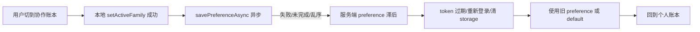
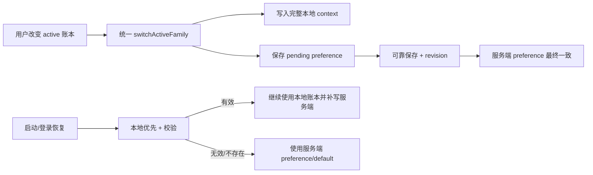
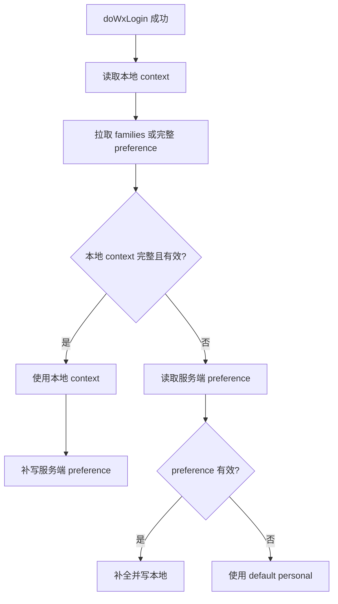
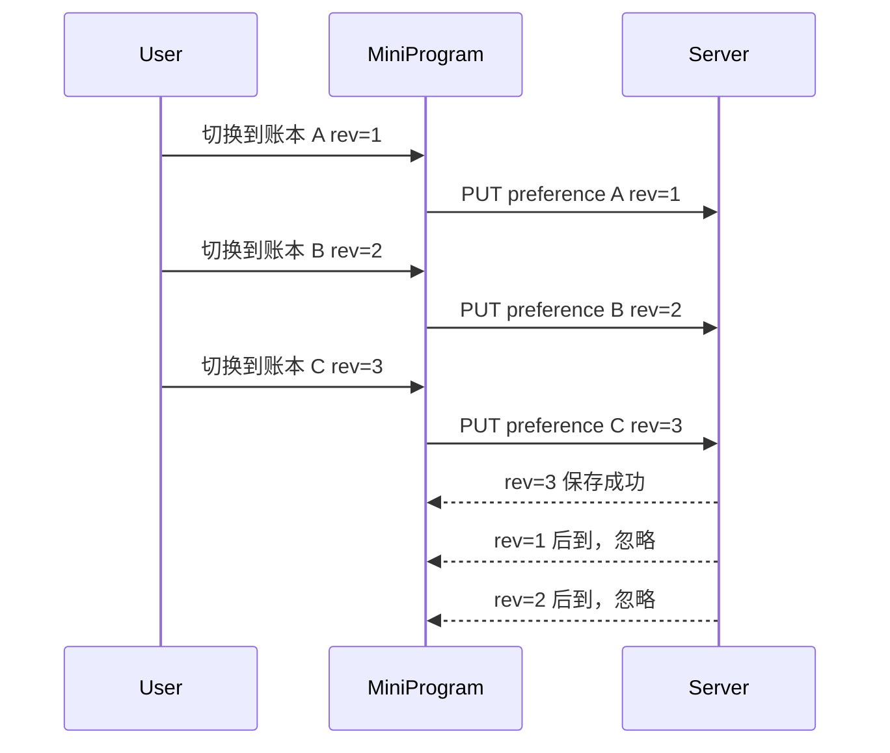
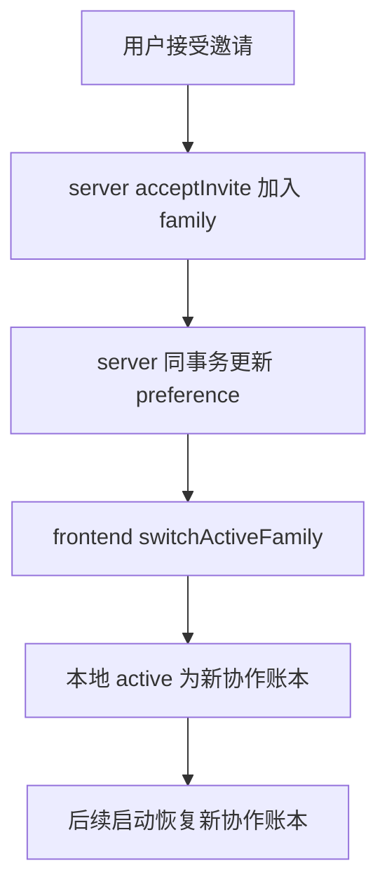

<!--
文档名称: Active 账本恢复稳定性修复需求文档
文档类型: 需求与技术方案
版本: v1.0
生成时间: 2026-06-09 15:51:00
需求来源: 用户测试反馈与代码链路分析
关联代码文件:
- miniprogram/services/family.ts
- miniprogram/services/auth.ts
- miniprogram/services/storage.ts
- miniprogram/services/request.ts
- miniprogram/pages/ledger/index.ts
- miniprogram/pages/statistics/index.ts
- miniprogram/pages/family/index.ts
- miniprogram/pages/invite-confirm/index.ts
- server/src/routes/users.ts
- server/src/repositories/userRepo.ts
- server/src/services/authService.ts
- server/src/services/familyService.ts
-->

# Active 账本恢复稳定性修复需求文档

## 目录

1. [背景与问题定义](#1-背景与问题定义)
2. [目标与非目标](#2-目标与非目标)
3. [现状链路](#3-现状链路)
4. [根因与风险分析](#4-根因与风险分析)
5. [修复原则](#5-修复原则)
6. [功能需求](#6-功能需求)
7. [服务端需求](#7-服务端需求)
8. [小程序端需求](#8-小程序端需求)
9. [数据与接口变更](#9-数据与接口变更)
10. [关键流程](#10-关键流程)
11. [测试与验收](#11-测试与验收)
12. [灰度、兼容与回滚](#12-灰度兼容与回滚)
13. [实施拆解](#13-实施拆解)

## 1. 背景与问题定义

测试中发现：偶现打开小程序后，默认打开的账本不是上次 active 的协作账本，而是个人账本。该问题没有稳定复现规律，表现更接近持久化恢复链路中的时序、失败重试或多数据源覆盖问题。

当前小程序通过本地 storage key `__costra_family_context_v1` 保存 active family/ledger，并通过服务端 `users.preferred_family_id`、`users.preferred_ledger_id` 在本地 storage 丢失后恢复用户上次选择。

正常冷启动、access token 有效、本地 context 存在时，页面会等待 `app.bootstrapPromise` 后再读取 active context，因此明细页本身不是典型“页面早读 storage”的竞态根因。

主要问题集中在：

- 本地 active context 与服务端 preference 的写入可靠性不一致。
- 重新登录时服务端旧 preference 或默认个人账本可能覆盖本地仍存在的协作账本。
- 邀请加入协作账本后未保存服务端 preference。
- 服务端 preference 补全 family 信息失败时会落盘半残 context，导致视觉上误判为个人账本。
- 清 storage、token 过期、网络失败、快速切换、无权限回退等异常路径缺少统一保护策略。

## 2. 目标与非目标

### 2.1 目标

- 用户最后一次主动选择的有效账本，应成为后续启动、登录恢复、异常恢复时的优先恢复目标。
- 本地 active context 与服务端 preference 最终一致。
- 所有 active 账本变更入口走统一 service，不在页面层分散拼接 `setActiveFamily + savePreferenceAsync`。
- 服务端 preference 写入支持权限校验与防旧请求覆盖。
- 登录、token 过期、清 storage、邀请加入、网络失败、快速切换、无权限账本等场景行为确定。
- 页面展示必须与真实账本状态一致，不允许把 unknown/partial context 误显示为“个人账本”。
- 增加日志与测试矩阵，便于复现和定位偶现问题。

### 2.2 非目标

- 不重做 family/ledger 数据模型。
- 不改变 family 与 ledger 当前 1:1 的产品语义。
- 不修改页面视觉设计。
- 不引入复杂跨端实时同步。
- 不取消个人账本；个人账本仍是最终安全兜底。
- 不通过硬编码“协作账本优先”解决问题，而是建立清晰恢复协议。

## 3. 现状链路

### 3.1 本地 active context

`miniprogram/services/family.ts` 中通过 `FAMILY_CONTEXT_KEY = '__costra_family_context_v1'` 保存：

- `family_id`
- `ledger_id`
- `family_kind`
- `ledger_name`

`setActiveFamily()` 写入本地 storage 后广播 `ACTIVE_FAMILY_CHANGED`。

### 3.2 页面启动读取

明细页 `pages/ledger/index.ts` 的 `onShow()` 会等待 `app.bootstrapPromise`，然后调用 `_loadContext()` 读取 active ledger/family，再加载流水。

因此正常冷启动下，只要 bootstrap 恢复出的 context 正确，页面会打开正确账本。

### 3.3 切账本写入

当前页面切账本通常执行：

1. `setActiveFamily(...)` 写本地。
2. `savePreferenceAsync(familyId, ledgerId)` fire-and-forget 写服务端。
3. 当前页面立即刷新。

本地体验即时生效，但服务端 preference 不具备强一致保证。

### 3.4 登录恢复

真实登录链路 `doWxLogin()` 当前策略：

1. 调用 `/auth/wx-login` 获取 token 和 default personal family/ledger。
2. 调用 `fetchAndRestorePreference()` 从服务端 preference 恢复。
3. 若服务端无 preference，则写入 default personal family。

该链路没有优先校验并保留本地仍存在的 active context。

## 4. 根因与风险分析

### 4.1 服务端 preference fire-and-forget 失败

`savePreferenceAsync()` 异步写服务端，失败仅 `console.warn`，没有 pending 队列和重试机制。

风险：

- 切到协作账本后立刻杀进程，服务端可能仍是旧个人账本。
- 网络失败时当前设备看起来已切换成功，但跨设备/清 storage/重新登录无法恢复。
- 失败是静默的，测试中表现为偶现。

### 4.2 登录路径覆盖本地 active context

access token 过期后，`initAuth()` 当前会让用户进入登录页；重新登录后 `doWxLogin()` 以服务端 preference/default 为主，不优先保留本地 context。

风险：

- 本地协作账本 context 仍存在，但服务端 preference 旧或空，登录后被默认个人账本覆盖。
- 与 `savePreferenceAsync` 失败组合后，极易复现“上次是协作账本，下次打开变个人账本”。

### 4.3 邀请加入未保存 preference

`pages/invite-confirm/index.ts` 接受邀请后写本地 active context，但未保存服务端 preference。服务端 `acceptInvite()` 也未同步更新用户 preference。

风险：

- 用户通过邀请加入协作账本后，当前设备短期正常。
- token 过期、清 storage 或重新登录后，服务端仍可能指向旧个人账本。

### 4.4 半残 context 导致视觉误判

`fetchAndRestorePreference()` 在 `/users/me/preference` 成功但 `/families` 补全失败时，仍写入只有 `family_id/ledger_id` 的 context。

风险：

- `family_kind` 为空时，页面会把多人态判断为 false。
- `ledger_name` 为空时，页面 fallback 到“个人账本”。
- 用户看到的是个人账本，但内部 ledger_id 可能其实是协作账本，造成状态混乱。

### 4.5 快速切换乱序覆盖

多个 `PUT /users/me/preference` 并发时，当前服务端按请求到达顺序覆盖写。

风险：

- 用户快速切 A → B → C，旧请求 A/B 后到，最终服务端 preference 可能不是 C。

### 4.6 storage 清理放大问题

`ensureVersion()` 在版本不一致时会 `wx.clearStorage()`。一旦本地 active context 和 token 被清，恢复完全依赖服务端 preference。

如果服务端 preference 滞后或为空，就会回到默认个人账本。

### 4.7 无权限/离开/解散回退不统一

离开协作账本、被移出、账本解散、API 返回 `FAMILY_NOT_MEMBER` 等路径都可能需要回退个人账本。若分散处理，容易出现：

- 误清有效 context。
- 回退 personal 后未保存 preference。
- 页面状态与 storage 不一致。

## 5. 修复原则

1. **单一入口**：所有 active family/ledger 变更通过统一 service 方法完成。
2. **本地优先但需校验**：本地 context 是当前设备最近选择，恢复时优先使用，但要校验用户仍有权限。
3. **服务端最终一致**：服务端 preference 是跨设备与本地丢失恢复来源，不允许长期滞后。
4. **最后写入胜出**：快速切换时，旧请求不能覆盖新选择。
5. **半残数据不落盘**：缺少 `family_kind/ledger_name` 的 context 不应作为完整 active context 写入。
6. **失败可恢复**：网络失败不阻塞本地体验，但必须 pending 并自动重试。
7. **保护性回退**：仅当确认账本无权限、不存在、被解散时才回个人账本。
8. **可观测**：关键恢复决策必须有脱敏日志。

## 6. 功能需求

### 6.1 统一 active 账本选择规则

恢复优先级：

1. 本地完整且有效的 active context。
2. 服务端完整且有效的 preference。
3. 服务端登录返回的默认 personal family/ledger。

本地 context 完整的定义：

- `family_id` 非空。
- `ledger_id` 非空。
- `family_kind` 为 `personal` 或 `shared`。
- `ledger_name` 非空。

本地 context 有效的定义：

- family 存在。
- ledger 属于该 family。
- 当前用户仍是该 family active member。

### 6.2 登录后合并策略

登录成功后不得直接使用服务端 preference/default 覆盖本地 context。

应执行：

1. 读取本地 active context。
2. 拉取 `/families` 或服务端完整 preference 进行有效性校验。
3. 若本地 context 完整且有效：
   - 使用本地 context。
   - 补写服务端 preference。
4. 若本地 context 无效或不存在：
   - 使用服务端 preference。
5. 若服务端 preference 也为空或无效：
   - 使用 default personal family。

网络失败时：

- 若本地 context 完整，不覆盖本地，不回退 personal。
- 若本地 context 不存在，允许使用服务端 preference 或 default 兜底。

### 6.3 token 过期保护

`initAuth()` 发现 access token 过期时：

- 若 refresh token 未过期，优先 `refreshToken()`。
- refresh 成功后继续使用本地 context 优先策略。
- refresh 失败才清 token 并进入登录页。
- 即使进入登录页，登录成功后也要执行合并策略。

### 6.4 可靠保存 preference

所有用户主动改变 active 账本的入口必须保存服务端 preference：

- 明细页切账本。
- 统计页切账本。
- 协作页切账本。
- 创建协作账本成功。
- 接受邀请加入协作账本成功。
- 无权限回退个人账本。

保存策略：

- 本地 context 立即写入，保证当前体验。
- 服务端保存失败时，写 pending preference 到本地 storage。
- 下次启动、登录成功、页面 show 或网络恢复后重试。
- 用户再次切换账本时，新 pending 覆盖旧 pending。
- 4xx 权限类错误停止重试并触发校验/回退。
- 网络错误保留 pending。

### 6.5 防乱序

每次 active 账本变更生成客户端 revision 或更新时间。

要求：

- 同端保存请求单飞或按 revision 顺序。
- 服务端只接受比当前更新的 preference。
- 旧 revision 请求返回成功但不覆盖当前 preference。
- pending retry 复用原 revision。

### 6.6 邀请加入同步

接受邀请成功后：

- 前端使用统一 active 账本切换方法写入完整 context。
- 前端立即保存服务端 preference。
- 服务端 `acceptInvite()` 在加入事务内同步更新当前用户 preference 到新加入协作账本。

采用前后端双保险，避免前端请求中断导致服务端偏好丢失。

### 6.7 partial context 防护

`fetchAndRestorePreference()` 不得写入缺少 `family_kind/ledger_name` 的完整 context。

规则：

- 若 GET preference 只返回 id，必须补全后再 `setActiveFamily()`。
- `/families` 补全失败时，返回 pending/partial 状态给调用方，不落盘半残 context。
- 页面发现 unknown 状态时显示“账本加载中”或保留旧展示，不 fallback 成“个人账本”。
- `getActiveLedgerName()` 不应对 unknown context 默认返回“个人账本”；只有明确 personal 时才允许。

### 6.8 无权限账本回退

当确认用户已无权限访问当前账本：

1. 清理当前无效 context。
2. 从 `/families` 获取 personal family。
3. 写入 personal active context。
4. 保存 personal preference。
5. 广播 `ACTIVE_FAMILY_CHANGED`。
6. 刷新页面数据。

只有当前 active/preference 正是无效账本时才回退，不误伤其他有效选择。

### 6.9 页面展示保护

页面不再把 unknown/partial 状态显示成个人账本：

- `familyKind === 'personal'`：可显示“个人账本”。
- `familyKind === 'shared'`：显示协作账本名称和多人筛选。
- `familyKind == null`：显示“账本加载中”或保留旧 title，不写回 personal。

## 7. 服务端需求

### 7.1 preference schema 扩展

新增字段建议：

- `users.preferred_updated_at timestamptz`
- `users.preferred_revision bigint`

`preferred_revision` 用于防止旧请求覆盖新选择。

### 7.2 PUT preference 校验

`PUT /users/me/preference` 必须校验：

- family 存在且未删除。
- ledger 存在且属于该 family。
- 当前用户是该 family active member。
- personal family 允许保存。
- 无权限返回明确业务错误，不写入 preference。

### 7.3 PUT preference 防旧覆盖

请求新增：

```ts
{
  preferred_family_id: string | null;
  preferred_ledger_id: string | null;
  client_revision?: number;
  client_updated_at?: string;
}
```

处理：

- 未传 revision：兼容旧客户端，按服务端当前时间覆盖。
- 传入 revision：仅当 `client_revision >= current preferred_revision` 时覆盖。
- 旧 revision：不覆盖，返回 204/200，并记录 stale 日志。

### 7.4 GET preference 增强

推荐返回完整 context：

```ts
{
  preferred_family_id: string | null;
  preferred_ledger_id: string | null;
  preferred_family_kind?: 'personal' | 'shared';
  preferred_ledger_name?: string;
  preferred_revision?: number;
  preferred_updated_at?: string;
}
```

服务端负责过滤无效 preference。若 preference 指向无权限/已删除 family，应返回 null 或自愈到 personal。

### 7.5 acceptInvite 同步 preference

`familyService.acceptInvite()` 加入成功后，同事务更新当前用户 preference 到邀请对应 family/ledger。

要求：

- 保证“加入成功”和“默认打开新协作账本”一致。
- 若 preference 更新失败，事务回滚，避免半成功状态。

## 8. 小程序端需求

### 8.1 统一 active ledger service

在 `miniprogram/services/family.ts` 扩展统一方法：

- `switchActiveFamily(ctx, options)`：写本地、广播、保存 preference 或 pending。
- `restoreActiveFamilyAfterLogin(defaultCtx)`：登录后合并本地和服务端偏好。
- `validateAndCompleteFamilyContext(ctx)`：通过 `/families` 校验并补全。
- `flushPendingPreference()`：重试未完成保存。
- `fallbackToPersonalFamily(reason)`：安全回退个人账本。

页面层不再直接拼接 `setActiveFamily + savePreferenceAsync`。

### 8.2 pending preference storage

新增 key：`__costra_pending_preference_v1`。

结构：

```ts
interface PendingPreference {
  family_id: string;
  ledger_id: string;
  family_kind: 'personal' | 'shared';
  ledger_name: string;
  client_revision: number;
  source: string;
  retry_count: number;
  last_error_code?: string;
  updated_at: number;
}
```

重试触发：

- app bootstrap 后。
- 登录成功后。
- 页面 show 的低频时机。
- 用户再次切账本时覆盖旧 pending。
- 网络恢复时。

### 8.3 替换页面散落调用

需替换：

- `pages/ledger/index.ts`
- `pages/statistics/index.ts`
- `pages/family/index.ts`
- `pages/invite-confirm/index.ts`
- `services/auth.ts`

### 8.4 日志与观测

新增脱敏日志：

- `restore decision`: local-valid / server-preference / default-personal / fallback-personal。
- `preference save`: start / success / failed / queued / flushed / stale。
- `partial context rejected`。
- `invalid family fallback reason`。

不得记录 token、openid、原始 wx code。

## 9. 数据与接口变更

### 9.1 Migration

新增 migration，例如 `0014_user_preference_revision.sql`：

```sql
ALTER TABLE users
  ADD COLUMN IF NOT EXISTS preferred_updated_at TIMESTAMPTZ,
  ADD COLUMN IF NOT EXISTS preferred_revision BIGINT NOT NULL DEFAULT 0;
```

同步更新：

- `server/test/setup.ts`
- `userRepo.UserEntity`
- `UserRow`
- `rowToEntity()`
- 相关 SELECT RETURNING 字段

### 9.2 API 兼容

旧客户端仍可调用旧 body：

```ts
{
  preferred_family_id: string | null;
  preferred_ledger_id: string | null;
}
```

新客户端传 revision 后获得防乱序能力。

## 10. 关键流程

### 10.1 当前问题链路



### 10.2 修复后恢复链路



### 10.3 登录合并流程



### 10.4 快速切换流程



### 10.5 邀请加入流程



## 11. 测试与验收

### 11.1 验收标准

- 切到协作账本后，正常冷启动仍打开该协作账本。
- 切到协作账本后，access token 过期并重新登录，仍打开该协作账本。
- 通过邀请加入协作账本后，后续重启/重新登录默认打开该协作账本。
- 切账本后断网，当前设备仍打开新账本；网络恢复后服务端 preference 自动补齐。
- 快速切换 A/B/C 后，无论请求返回顺序如何，最终恢复 C。
- `GET /users/me/preference` 成功但 `/families` 失败时，不显示成个人账本假象。
- 清 storage 后，若服务端 preference 正确，能恢复到上次协作账本。
- 用户被移出协作账本后，启动安全回退个人账本，并保存 personal preference。

### 11.2 测试矩阵

| 场景 | 本地 context | 服务端 preference | 网络 | 预期 |
| --- | --- | --- | --- | --- |
| token 有效冷启动 | 协作完整 | 任意 | 正常 | 使用本地协作 |
| token 过期 refresh 成功 | 协作完整 | 个人旧值 | 正常 | 使用本地协作并补写服务端 |
| 重新登录 | 协作完整 | 空 | 正常 | 使用本地协作 |
| 清 storage | 无 | 协作有效 | 正常 | 使用服务端协作 |
| 清 storage | 无 | 空 | 正常 | 使用默认个人 |
| 切账本后 PUT 失败 | 新协作 | 旧个人 | 断网 | 当前设备保留新协作，pending 重试 |
| 快速切换 | C | A/B 请求后到 | 正常 | 最终 C |
| 邀请加入 | 新协作 | 旧个人/空 | 正常 | 新协作成为默认 |
| preference 补全失败 | id 存在但无 kind/name | 协作 | `/families` 失败 | 不落盘半残 context，不显示个人假象 |
| 被移出账本 | 旧协作 | 旧协作 | 正常 | 回退个人并更新 preference |

### 11.3 自动化测试

小程序端：

- `family.ts`：完整 context、partial context、pending preference、flush、fallback、防乱序。
- `auth.ts`：access 过期 refresh、本地 context 优先、登录合并、服务端旧 preference 不覆盖本地。
- 页面层：切账本调用统一 service，unknown 状态不显示个人账本。

服务端：

- `PUT /users/me/preference` 权限校验。
- revision 旧请求不覆盖新请求。
- `GET /users/me/preference` 返回完整 context。
- `acceptInvite()` 更新 preference。
- migration 与 `server/test/setup.ts` 对齐。

## 12. 灰度、兼容与回滚

### 12.1 灰度

- 新 preference 字段向后兼容。
- 旧客户端不传 revision 仍可保存。
- 小程序端先记录 restore decision 日志，便于线上观察。

### 12.2 回滚

- 服务端新增字段可保留不使用。
- 小程序统一 service 可回滚到旧调用路径。
- pending preference storage 可安全清理，不影响账本数据本身。

### 12.3 风险

- 过度信任本地 context 可能短暂展示已无权限账本；通过后台校验与 403 fallback 处理。
- 客户端时间戳可能不可靠；推荐使用本地单调 revision。
- `acceptInvite()` 同事务更新 preference 后，需确保 repo 更新稳定，避免加入失败。

## 13. 实施拆解

1. 生成并提交本需求文档。
2. 服务端增加 preference revision/updated_at、权限校验、完整 preference 返回。
3. 服务端 `acceptInvite()` 成功后同步 preference。
4. 小程序端扩展 `family.ts`：统一切换、登录恢复合并、pending preference、flush、partial 防护、fallback personal。
5. 修改 `auth.ts`：access 过期优先 refresh；登录成功走合并策略。
6. 替换页面层切账本/邀请加入/回退逻辑。
7. 补充小程序和服务端测试矩阵。
8. 技术与产品审查，重点审查恢复优先级、异常回退和用户感知。

## 变更记录

| 版本 | 日期 | 变更内容 |
| --- | --- | --- |
| v1.0 | 2026-06-09 | 初始版本，整理 active 账本恢复稳定性修复需求与技术方案。 |
