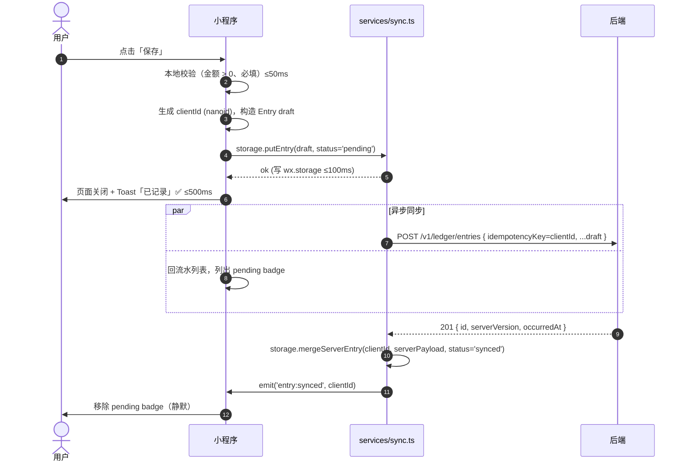
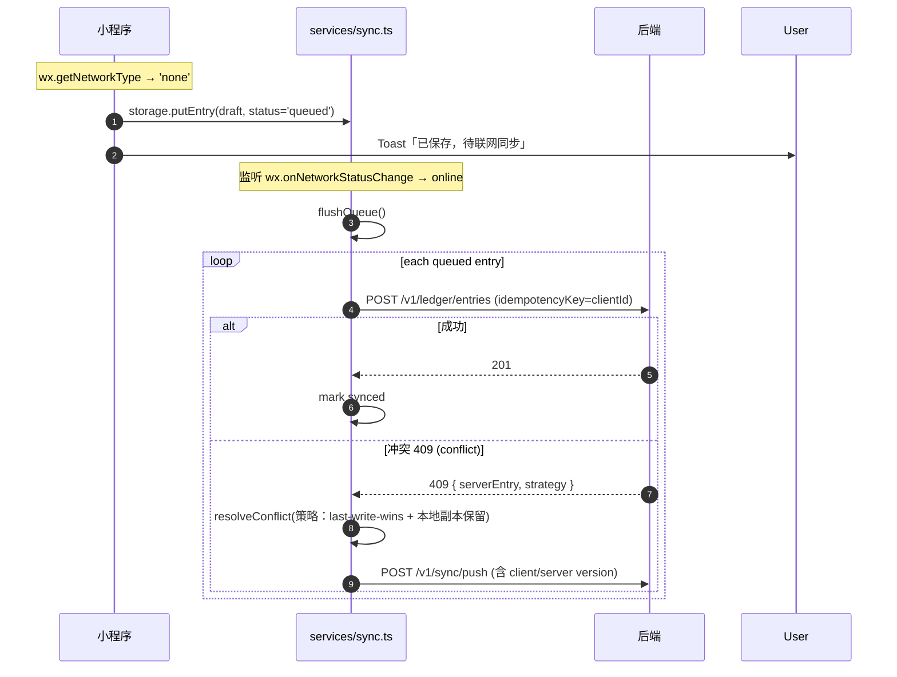

# 流程时序 · 记一笔（本地先写 + 异步同步）

> **卡号**：COSTRA-010 · **关联 Story**：COSTRA-113 / 121 / 122 / 123
> **耗时预算**：用户点保存 → UI 闭合 **≤ 500ms**；后台同步 p95 ≤ 800ms；离线场景 0 阻塞

---

## 1. 场景

用户在 `pages/entry-edit` 点"保存"，**必须立即 UI 成功**（关键体验），同步晚几百毫秒不影响。

## 2. 主路径（在线）



## 3. 离线路径



## 4. 冲突策略（对齐 COSTRA-123）

```
策略：last-write-wins（基于 serverVersion）
  + 本地总是保留一份 "conflict-keep" 副本，在流水中以"🔀 冲突"标记
  + 用户可点开 → 选择保留本地 / 保留服务端 / 合并
```

详见 `docs/api/conflict-strategy.md`（Backend 同步交付）。

## 5. 数据一致性 Invariants

- `clientId` 全局唯一，由前端生成（nanoid），与 `Idempotency-Key` Header 一致
- 服务端每次返回 `serverVersion`（BIGINT），前端更新本地 `version`
- `/v1/sync/pull` 的 cursor = `max(serverVersion) ∀ entries`
- **用户永远看不到"保存失败"Toast**（除非本地校验失败）

## 6. 金额处理（对齐 ADR-0004 §8）

- UI 层：`AmountInput` 组件接受字符串 "12.34"
- 存储层：统一转 `BIGINT 分` = `1234`
- 传输层：OpenAPI 的 `amountMinor: string`（JS number 精度不够，必须字符串整数）

## 7. 性能预算

| 环节 | p50 | p95 | 手段 |
|---|---|---|---|
| 本地校验 | 5ms | 50ms | 纯 JS |
| wx.storage 写 | 30ms | 100ms | `wx.setStorage`（异步）|
| UI 闭合 | 200ms | 500ms | setData 最小化（仅影响的行）|
| 云同步往返 | 300ms | 800ms | 含 code2Session 缓存、CDN |

## 8. 官方引用

- `wx.getStorage`：https://developers.weixin.qq.com/miniprogram/dev/api/storage/wx.getStorage.html
- `wx.onNetworkStatusChange`：https://developers.weixin.qq.com/miniprogram/dev/api/device/network/wx.onNetworkStatusChange.html
- setData 性能：https://developers.weixin.qq.com/miniprogram/dev/framework/performance/tips-runtime-setData.html

---

**Refs**: COSTRA-010 · **Impacts**: COSTRA-020 `/v1/ledger/entries` + `/v1/sync/*`、COSTRA-030 storage / sync service
