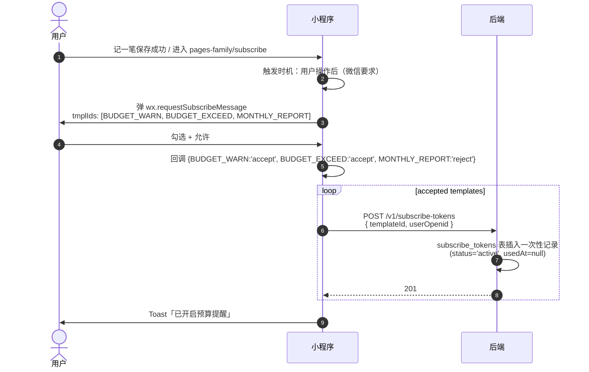
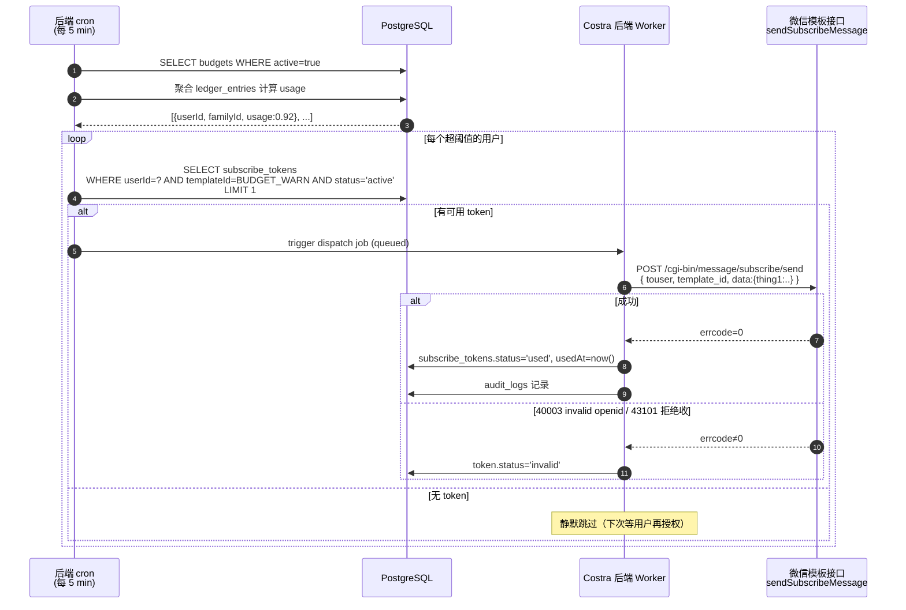

# 流程时序 · 预算超支订阅消息下发

> **卡号**：COSTRA-010 · **关联 Story**：COSTRA-203 / 301 / 302
> **耗时预算**：用户授权 ≤ 1s；后端 cron 检测 ≤ 5min 粒度；下发 API p95 ≤ 800ms

---

## 1. 双阶段设计

订阅消息（`requestSubscribeMessage`）是**一次授权 = 一次下发**。因此设计为：
- **阶段 A · 授权收集**：用户记账/设置预算时顺势弹出授权，把一次性 `subscribeToken` 入库
- **阶段 B · 触发下发**：后端 cron 5 分钟一次聚合"当前预算使用率 ≥ 80% 或超支"的用户，消费一个 token 下发微信

## 2. 阶段 A · 授权收集

**注意**：每次 `requestSubscribeMessage` **只能换一次下发权**。若用户选"总是保持以上选择"则每次可不弹，但**授权仍是一次性**，库里要持续积累。

## 3. 阶段 B · cron 检测 + 下发

## 4. 模板清单

| 模板 ID 占位 | 名称 | 触发条件 | 关键字段 |
|---|---|---|---|
| `BUDGET_WARN` | 预算达 80% 提醒 | 使用率 ≥ 0.8 且 < 1.0 | 预算名称 / 已用金额 / 剩余 / 时间 |
| `BUDGET_EXCEED` | 预算超支 | 使用率 ≥ 1.0 | 预算名称 / 超出金额 / 当前总支出 |
| `MONTHLY_REPORT` | 月度报告 | 每月 1 号早 9 点 | 月份 / 总支出 / 最大分类 / 跳转路径 |

实际模板 ID 由 Human 在微信后台申请（见 charter §9 资源清单）→ 填入 `env.prod.json`。

## 5. 触发时机矩阵（符合微信规则）

| 授权时机 | 是否合规 | 说明 |
|---|---|---|
| 用户点「保存」后 | ✅ | 用户主动行为 |
| 进入"我的订阅"页点"开启" | ✅ | 主动点击 |
| 启动小程序时 | ❌ | 违反微信规则，会被拒 |
| 静默定时弹 | ❌ | 违反 |

## 6. 跳转策略

- 订阅消息模板里 `page` 字段指向 `pages-family/budget?id={budgetId}`（2024 年微信已强制要求携带 page）
- 用户点击消息 → 直达预算页 → 看到超支详情 + 调整预算按钮

## 7. 隐私与文案

- 模板内容 **不得出现具体金额的高精度**（官方审核要求，"已用 1234 元"✅ / "1234.56 元"也✅，但不能有身份证/手机号）
- 每条模板文案必须通过 `docs/qa/wechat-review-checklist.md` 自查

## 8. 官方引用

- `wx.requestSubscribeMessage`：https://developers.weixin.qq.com/miniprogram/dev/api/open-api/subscribe-message/wx.requestSubscribeMessage.html
- 订阅消息服务端下发：https://developers.weixin.qq.com/miniprogram/dev/api-backend/open-api/subscribe-message/subscribeMessage.send.html
- 订阅消息使用说明：https://developers.weixin.qq.com/miniprogram/dev/framework/open-ability/subscribe-message.html
- 微信定时任务最佳实践：https://developers.weixin.qq.com/miniprogram/dev/wxcloud/guide/functions/timed-function-trigger.html

---

**Refs**: COSTRA-010 · **Impacts**: COSTRA-020 `/v1/subscribe-tokens`、COSTRA-021 `subscribe_tokens` 表、COSTRA-050 冒烟-5
