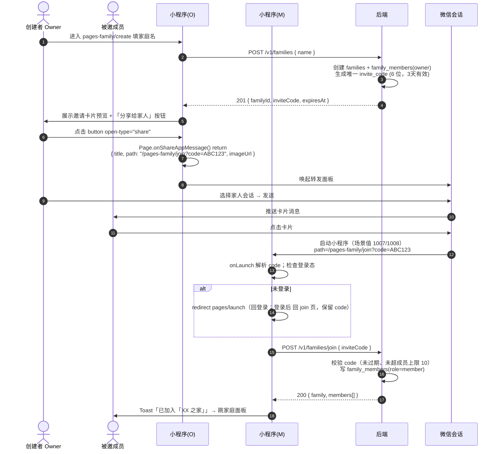

# 流程时序 · 家庭邀请（邀请码 + 分享卡片）

> **卡号**：COSTRA-010 · **关联 Story**：COSTRA-201 / 202 / 204
> **耗时预算**：生成邀请码 ≤ 600ms；分享卡片渲染 ≤ 300ms；加入家庭 ≤ 1s

---

## 1. 两种入口

1. **创建方**：Owner 在 `pages-family/create` 创建家庭 → 生成 6 位邀请码 → 唤起 `onShareAppMessage`
2. **加入方**：被邀用户通过微信分享卡片点击 → 场景值 1007/1008 → 自动落 `pages-family/join?code=xxx` → 一键加入

## 2. 主路径



## 3. 邀请码规范

- **格式**：`[A-Z0-9]{6}`（排除易混字符 O/0/I/1，实际字符集 32 位）
- **有效期**：3 天（ADR-0004 §安全原则，可 R2 调整）
- **唯一性**：数据库唯一约束 + 生成时 3 次重试
- **吊销**：Owner 可在 `pages-family/invite` 点"重新生成"，旧码立即失效
- **成员上限**：10 人（PRD NFR-SEC-2 家庭人数边界）

## 4. 分享卡片设计（详见 `docs/design/share-cards/family-invite.md`）

```
卡片封面 500×400（官方推荐 5:4）
 ├─ 标题（≤20 字）："一起加入「{familyName}」记账"
 ├─ 背景图：品牌主色渐变 + 家庭手绘元素
 ├─ 动态变量：{familyName}、{inviterNickname}
 └─ 底部：Costra logo + 「点击加入」
```

## 5. 场景值与 Deep Link 兼容

| 场景 | 入口 | 落地 |
|---|---|---|
| 1007 单聊会话 | 卡片 | `pages-family/join?code=xxx` |
| 1008 群聊会话 | 卡片 | 同上 |
| 1047 扫码（海报/朋友圈图）| 解析 URL | 同上 |
| 1037 直接打开 | 无 code | `pages-family/dashboard`（已是成员）or 引导创建 |

## 6. 错误兜底

| 错误 | 用户感知 |
|---|---|
| `INVITE_CODE_EXPIRED` | "邀请码已过期，请让家人重新分享" |
| `INVITE_CODE_INVALID` | "邀请码不存在" |
| `FAMILY_MEMBER_LIMIT` | "家庭人数已达上限（10 人）" |
| `ALREADY_IN_ANOTHER_FAMILY` | "当前已在「A 家」，请先退出" |

## 7. 官方引用

- `onShareAppMessage`：https://developers.weixin.qq.com/miniprogram/dev/reference/api/Page.html#onShareAppMessage-Object-object
- 分享卡片规范：https://developers.weixin.qq.com/miniprogram/dev/framework/open-ability/share.html
- 场景值：https://developers.weixin.qq.com/miniprogram/dev/reference/scene-list.html
- button open-type=share：https://developers.weixin.qq.com/miniprogram/dev/component/button.html

---

**Refs**: COSTRA-010 · **Impacts**: COSTRA-020 `/v1/families/*`、COSTRA-030 pages-family、COSTRA-050 冒烟-4
