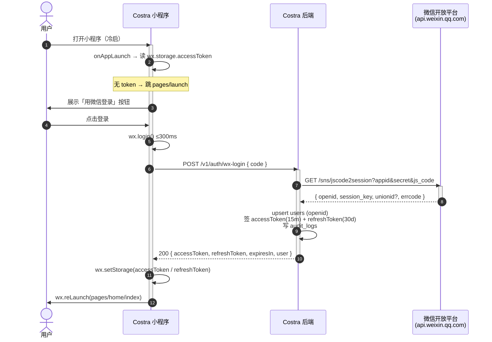
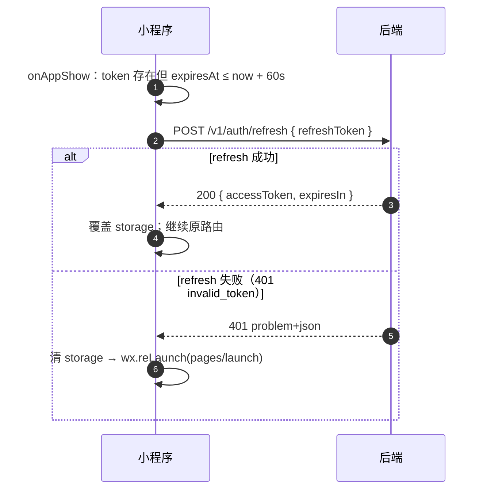
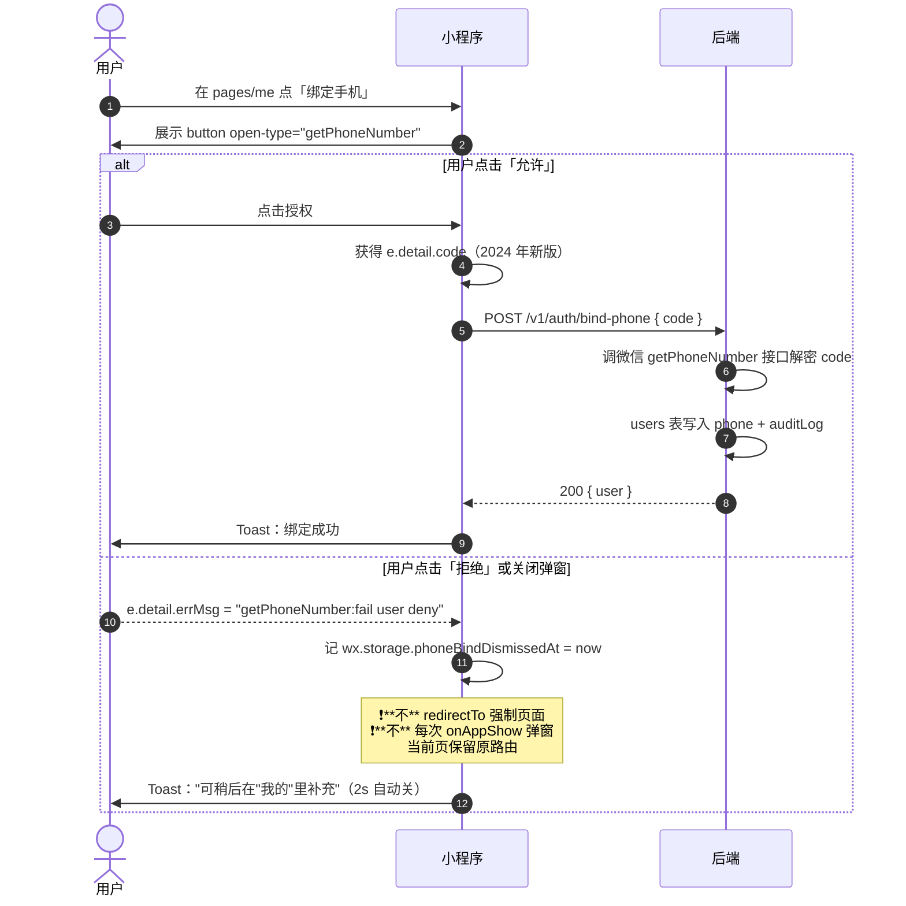

# 流程时序 · 微信登录闭环

> **卡号**：COSTRA-010 · **关联 Story**：COSTRA-101 / 102 / 103
> **耗时预算**：整体 ≤ 2s（p95） · `wx.login` 本地 ≤ 300ms · `code2Session` 服务端侧 ≤ 500ms · JWT 签发 ≤ 50ms

---

## 1. 场景与目标

- 用户首次进入 Costra 小程序 → 3 秒内拿到 `accessToken`，落 `wx.storage`，跳首页
- 冷启/热启检测 token 过期 → 静默 refresh，不打断用户
- token 无法恢复 → 回到 `pages/launch` 重新走 wx.login

---

## 2. 主路径（首次登录）

**耗时预算**：① wx.login ≤ 300ms · ② 后端整体 ≤ 500ms（含 code2Session 和入库）· ③ 客户端存储 + reLaunch ≤ 200ms · 端到端 **p95 ≤ 1.2s**。

---

## 3. 热启 + token 过期静默续签

**风险护栏**：
- 同时并发多个 401 时，请求队列在 `services/request.ts` 侧做**单次 refresh 互斥锁**（对齐 ADR-0004 §3）
- `refreshToken` 永不放 URL，只在 body / Authorization 里

---

## 4. 手机号绑定（R2 启用，MVP 可跳过）

**分支策略（对齐 IA §4.1 AuthPartial 与 §4.2 守卫）**：

- **MVP / R1 默认："允许跳过、关键操作再拦截"**。用户拒绝绑定后，允许自由使用记账/统计；**仅当用户触发以下关键操作**时再次弹绑定提示：
  - 创建家庭（COSTRA-201） — 邀请码短信/客服回访需手机
  - 订阅消息授权（COSTRA-203） — 非强依赖但建议引导
  - 账户申诉 / 数据导出（R3）
- **冷却期**：一次拒绝后 **7 天内** 不再自动弹；超过 7 天在关键操作前再弹一次。
- **不阻塞 AuthRequired 页面**：IA §4.2 守卫逻辑 **不** 把"未绑手机"视为未登录；只在"关键操作拦截"时 `wx.showModal` 引导到 `pages/bind-phone`。

引用：[getPhoneNumber（新版）](https://developers.weixin.qq.com/miniprogram/dev/framework/open-ability/getPhoneNumber.html)。

---

## 5. 错误兜底矩阵

| 错误码 | 场景 | 客户端行为 | 用户感知 |
|---|---|---|---|
| `wx.login` fail | 网络不通 | 重试 1 次，1s 退避 | Toast "登录失败，请检查网络" |
| `code2Session` errcode=40029 | code 失效 | 重新 wx.login | 无感知 |
| `40163` code 已使用 | code 被复用 | 重新 wx.login | 无感知 |
| `refresh` 401 | refreshToken 失效 | 清 storage → 回 launch | "登录已过期" |
| 后端 5xx | 服务不可用 | 指数退避 3 次 | "稍后重试" |

---

## 6. 存储字段（对齐 ADR-0004 §3）

| Key | 内容 | 有效期 |
|---|---|---|
| `accessToken` | JWT | 15 min |
| `refreshToken` | 不透明字符串 | 30 d（可滑动）|
| `tokenExpiresAt` | ISO string | 同 accessToken |
| `currentUser` | `{ userId, nickName, avatarUrl, familyId? }` | 持久 |

---

## 7. 官方引用

- `wx.login`：https://developers.weixin.qq.com/miniprogram/dev/api/open-api/login/wx.login.html
- `code2Session`：https://developers.weixin.qq.com/miniprogram/dev/OpenApiDoc/user-login/code2Session.html
- `getPhoneNumber`：https://developers.weixin.qq.com/miniprogram/dev/framework/open-ability/getPhoneNumber.html
- `wx.reLaunch`：https://developers.weixin.qq.com/miniprogram/dev/api/route/wx.reLaunch.html

---

**Refs**: COSTRA-010 · **Impacts**: COSTRA-020 `/v1/auth/*`、COSTRA-030 request 层 / auth.service、COSTRA-050 冒烟-1
