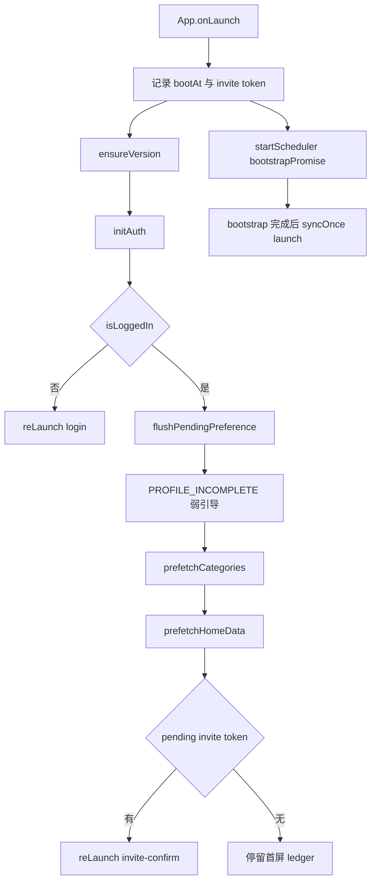
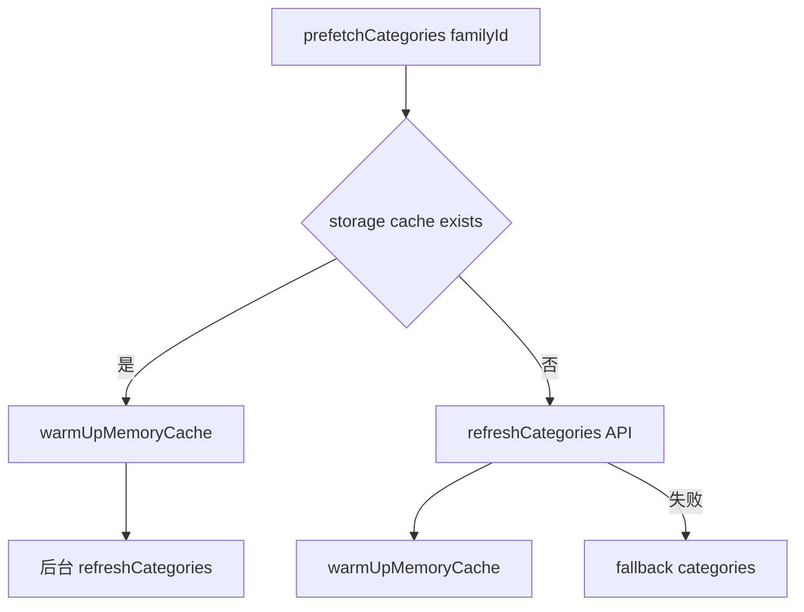
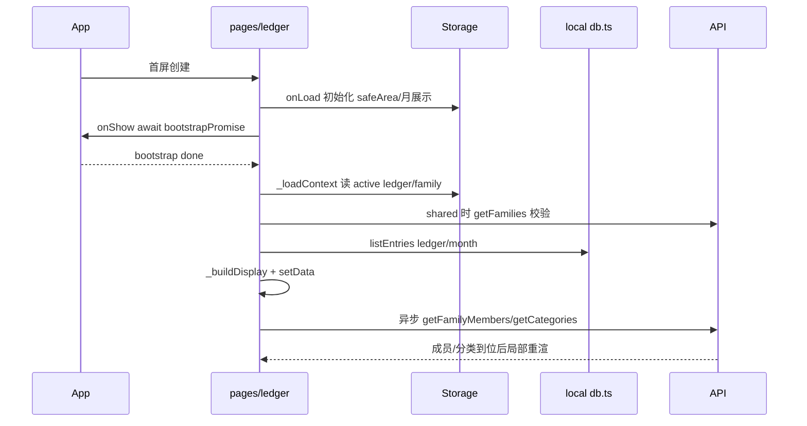
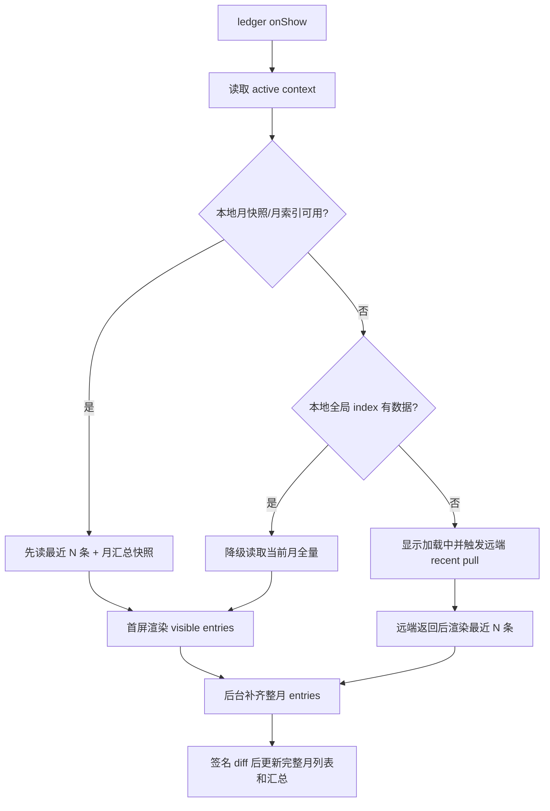
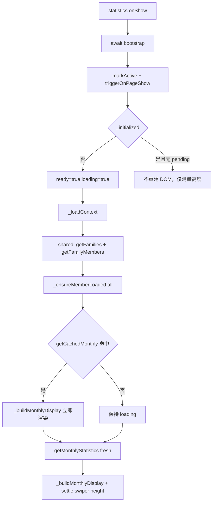
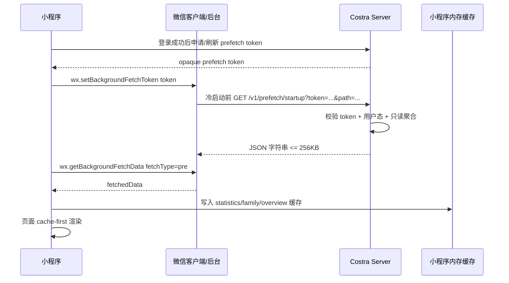
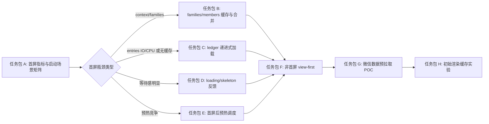

<!--
文档名称: 小程序启动与切页性能优化分析
文档类型: 性能分析与技术方案
版本: v1.2
生成时间: 2026-06-09 17:55:00
需求来源: 启动体验优化专项分析
关联代码文件:
- miniprogram/app.ts
- miniprogram/app.json
- project.config.json
- miniprogram/services/prefetch.ts
- miniprogram/services/categoryService.ts
- miniprogram/services/request.ts
- miniprogram/services/statisticsApi.ts
- miniprogram/services/familyApi.ts
- miniprogram/services/userOverviewApi.ts
- miniprogram/services/db.ts
- miniprogram/services/syncScheduler.ts
- miniprogram/pages/ledger/index.ts
- miniprogram/pages/statistics/index.ts
- miniprogram/pages/family/index.ts
- miniprogram/pages/mine/index.ts
官方资料:
- https://developers.weixin.qq.com/miniprogram/dev/framework/ability/pre-fetch.html
-->

# 小程序启动与切页性能优化分析

## 目录

1. [结论摘要](#1-结论摘要)
2. [现有启动与预加载链路](#2-现有启动与预加载链路)
3. [现有预加载机制评估](#3-现有预加载机制评估)
4. [页面级加载与渲染瓶颈](#4-页面级加载与渲染瓶颈)
5. [微信数据预拉取机制评估](#5-微信数据预拉取机制评估)
6. [优化方案分层与优先级](#6-优化方案分层与优先级)
7. [建议实施路线](#7-建议实施路线)
8. [指标与验收方案](#8-指标与验收方案)
9. [风险与边界](#9-风险与边界)
10. [最终建议](#10-最终建议)

## 1. 结论摘要

Costra 当前已经具备一套较完整的启动后预热机制：

- `app.ts` 在已登录 bootstrap 完成后预热分类、统计页当月统计、协作页当月汇总。
- `statisticsApi.ts`、`familyApi.ts`、`userOverviewApi.ts` 已有 5 分钟 TTL 的 SWR 缓存。
- `categoryService.ts` 已有 storage -> memory -> API -> fallback 的分类预热链路。
- `syncScheduler.ts` 在 bootstrap 后立即启动同步，并在切页时 5 秒 debounce 触发同步。
- `app.json` 已启用 `lazyCodeLoading: "requiredComponents"`，并配置了 ledger 首屏后的分包预下载。

但当前体验仍有优化空间，主要不在“完全没有预加载”，而在以下四类：

1. **首屏 ready gate 成本**：`ledger` 首屏必须等待 `bootstrapPromise` 后才渲染，避免未登录闪屏是正确的，但已登录冷启动也会在 `ensureVersion + initAuth` 前空白。
2. **切页 context 与成员/家庭列表重复成本**：`statistics`、`family` 首次进入即使命中统计/summary 缓存，仍要读 active context、请求 `getFamilies()` / `getFamilyMembers()` 或重建成员 tabs。
3. **缓存粒度仍停留在原始 API 响应**：`prefetchHomeData()` 预热的是 API response，页面首次进入仍要构建 view-model、多次 `setData`、测量 swiper 高度。
4. **官方数据预拉取尚未接入**：当前预热发生在小程序 JS 运行、鉴权恢复之后；微信数据预拉取可以把部分服务端聚合数据提前到代码包加载前，但需要专用只读鉴权设计。

综合评估（已纳入“首界面优先”补充原则）：

- 启动优化必须先服务用户首先看到的 `ledger` 首屏：先让明细页所需的登录态、active context、本地 entries、必要分类和首帧渲染尽快完成。
- `statistics`、`family`、`mine` 的预热只能在不抢占首屏关键路径的前提下进行；如果资源竞争，应延后到 `ledger` 首次内容可见之后。
- 明细页应优先利用本地缓存；有缓存先显示缓存，无缓存再触发远端拉取，并通过“最近 N 条先显示、整月数据后台补齐”的递进式加载降低首屏等待。
- 数据尚未就绪时不应长时间空白，应显示明确的加载中、骨架屏或轻提示，缓解等待并避免把“加载中”误判为空状态。
- 优化任务拆成独立任务包推进，每个任务包单独验证收益和回归风险，避免把缓存、渲染、微信预拉取、索引重构混在同一次改动中。

| 优化方向 | 预期收益 | 风险 | 建议优先级 |
|---|---:|---:|---:|
| 首界面优先调度与启动阶段埋点 | 高，先保障用户第一眼体验并定位真实瓶颈 | 低 | P0 |
| 启动场景矩阵与缓存优先策略 | 高，覆盖冷启/热启/无缓存/弱网等真实路径 | 低 | P0 |
| 数据未就绪时的加载中/骨架反馈 | 中高，降低空白等待焦虑并避免误判为空态 | 低 | P0 |
| `getFamilies/getFamilyMembers` TTL 缓存 + in-flight 去重 | 高，直接减少 shared 首屏和切页重复请求 | 低 | P0 |
| `ledger` entries 月索引 / 最近 N 条递进式加载 | 中高，数据量大或无完整月缓存时直接改善首屏 | 中 | P1，需指标触发 |
| `prefetchHomeData` 升级为 view-model 预构建 | 中高，减少首次切统计/协作的 JS + setData 成本 | 中 | P1 |
| `family` 页再次切回避免 `loading=true` 闪烁 | 中，改善体感 | 低 | P1 |
| 微信数据预拉取 POC | 中，主要改善冷启动后快速进入统计/协作/我的 | 中高 | P1/P2，独立任务 |
| 初始渲染缓存 | 不确定，需真机验证 | 中 | P2 |
| 分包重构 Tab 页 | 收益不确定，改动大 | 高 | 暂不建议 |

## 2. 现有启动与预加载链路

### 2.1 冷启动主链路

`miniprogram/app.ts` 的 `onLaunch()` 当前执行顺序如下：



关键事实：

- `ensureVersion()` 必须先于 `initAuth()`，用于 storage 版本校验。
- `initAuth()` 会从 storage 恢复 token，access 过期但 refresh 有效时会静默续签。
- 未登录时立即 `reLaunch('/pages/login/index')`。
- 已登录时，分类预热与首页数据预热都是 fire-and-forget，不阻塞首屏。
- `startScheduler(this.bootstrapPromise)` 会等待 bootstrap 完成后触发 `syncOnce('launch')`。

### 2.2 登录成功链路

登录页 `pages/login/index.ts` 在 `loginFlow()` 成功后：

1. 根据画像完善状态发出 `PROFILE_INCOMPLETE`。
2. 处理邀请 token。
3. 立即 `syncOnce('launch')`。
4. fire-and-forget `prefetchHomeData()`。
5. `reLaunch('/pages/ledger/index')`。

这覆盖了“刚登录后立刻进入首页”的场景，避免只在 `app.ts` 已登录路径才预热。

### 2.3 首屏页面配置

`miniprogram/app.json` 当前关键配置：

```json
{
  "pages": [
    "pages/ledger/index",
    "pages/statistics/index",
    "pages/add-placeholder/index",
    "pages/family/index",
    "pages/mine/index"
  ],
  "preloadRule": {
    "pages/ledger/index": {
      "network": "all",
      "packages": ["stat", "family"]
    }
  },
  "lazyCodeLoading": "requiredComponents"
}
```

评估：

- `pages/ledger/index` 是首屏，符合产品主路径。
- 五个 Tab 页都在主包内，Tab 切换不会下载分包；当前 `preloadRule` 预下载的是 `pages-stat/`、`pages-family/` 子包，主要覆盖设置、公告、隐私等非核心 Tab 页面。
- 已启用按需注入组件，有利于减少未使用组件初始化成本。
- 未配置 `initialRenderingCache`，可作为实验项，但不是当前最确定收益点。
- `project.config.json` 中 `preloadBackgroundData: false`，项目未接入微信数据预拉取调试/后台数据能力。

### 2.4 启动场景与缓存策略矩阵

启动优化不能只覆盖“已登录、有缓存、网络正常”的理想路径，需要按场景决定首屏数据来源和用户反馈：

| 场景 | 首屏数据来源 | 处理策略 |
|---|---|---|
| 已登录冷启动，有本地 active context 和当月 entries | 本地 storage / 月索引 / 月快照 | 先渲染本地缓存，首帧后再触发同步和非首屏预热 |
| 已登录冷启动，无 entries 缓存或缓存不完整 | 远端同步 / 最近流水接口 | 先显示加载中或骨架；优先拉最近 N 条用于首屏，再后台补齐整月 |
| 已登录冷启动，access 过期但 refresh 有效 | refresh 后恢复本地/服务端 preference | 登录态恢复期间不显示旧敏感数据；恢复完成后按缓存优先策略渲染 |
| 未登录冷启动 | 无业务数据 | 保持 ready gate，不展示旧用户账本，跳转登录 |
| shared 账本冷启动 | 本地 context + families 校验 | 有 families 短缓存时先校验缓存；无缓存时显示账本验证中，避免误判为空账本 |
| 弱网/离线启动 | 本地缓存 | 有缓存先显示“离线数据”；无缓存显示加载失败/重试，而不是空账本 |
| 热启动/后台恢复 | 已有页面状态 | 保留当前画面，后台校准；除非账本或月份变化，不进入全屏 loading |
| 切账号/退出登录后启动 | 无可信缓存 | 清理或隔离用户缓存，禁止初始渲染缓存闪旧数据 |

核心原则：能确定属于当前用户、当前账本、当前月份的本地缓存，优先用于首屏；缓存缺失或身份不确定时，优先给出加载反馈，再拉远端数据。

## 3. 现有预加载机制评估

### 3.1 分类预热：`prefetchCategories`

当前机制：



优点：

- 对记账面板体验帮助明显：打开面板时可同步读取内存分类，弱网也有 fallback。
- storage cache 命中时不阻塞网络。
- 分类更新后通过事件触发页面重渲，避免首屏被分类请求阻塞。

可优化点：

- 当前分类预热与 `ledger._loadContext()` 内的 `getCategories(familyId)` 可能都触发刷新；需要确认 `categoryService` 内部是否已有 in-flight 合并。如果没有，可补同 familyId 的 in-flight 去重。
- 对首屏明细页来说，分类未到位时可能先显示 fallback/未分类，再更新；这是速度与准确性的权衡，现策略合理。

### 3.2 首页数据预热：`prefetchHomeData`

当前机制：

```ts
getActiveFamilyId()
  -> getMonthlyStatistics(familyId, currentMonth, { topN: 50 })
  -> getFamilySummary(familyId, { month: currentMonth }, { topN: 20 })
```

优点：

- 覆盖统计页、协作页首次切 Tab 的主要服务端聚合数据。
- 复用现有 `statisticsApi`、`familyApi` 缓存，不额外引入缓存层。
- fire-and-forget，失败不影响启动。

限制：

- 只预热“全部成员”的当月数据；统计页切到具体成员仍需网络请求。
- 只预热原始 API response，页面仍要构建 view-model。
- 预热发生在 JS 启动并完成鉴权恢复之后，无法覆盖代码包加载前的等待。
- 不预热 `getFamilies()`、`getFamilyMembers()`，所以统计/协作首次进入仍可能等待成员和家庭上下文。

### 3.3 SWR 缓存

| 模块 | 缓存对象 | TTL | 当前使用场景 | 缺口 |
|---|---|---:|---|---|
| `statisticsApi.ts` | monthly/yearly statistics | 5 分钟 | 统计页 cache-first 后 fresh | 无 in-flight 合并；只缓存 API response |
| `familyApi.ts` | family summary | 5 分钟 | 协作页 cache-first 后 fresh | `getFamilies/getFamilyMembers` 无缓存 |
| `userOverviewApi.ts` | user overview | 5 分钟 | 我的页 cache-first 后 refresh | 未接入启动预热 |
| `categoryService.ts` | categories | 24 小时 storage + memory | 记账面板/明细分类展示 | 可补请求合并 |

总体判断：SWR 方向正确，但缓存范围还不够覆盖“页面进入前置 context 数据”。

### 3.4 同步调度

`syncScheduler.ts` 当前触发源：

- `launch`
- `network-recover`
- `page-show`
- `periodic`
- `mutation`
- `hide`
- `conflict-retry`
- `ledger-switch`

优点：

- launch sync 等 bootstrap 完成，避免登录态未就绪的 race。
- page-show 有 5 秒 debounce，避免连续切 Tab 触发大量同步。
- `SYNC_DONE` 只在 pushed/pulled 非零时广播，避免空同步导致页面刷新。

风险：

- `syncOnce()` 内 push 后 pull 是串行网络请求，若在首屏阶段和页面 fresh 请求同时发生，可能形成网络竞争。
- 对首屏明细页来说，pull 完成后可能触发 `_refreshIfChanged()`，产生启动后一段时间的二次渲染；这是正确性需要，但要通过签名 diff 控制跳动。

## 4. 页面级加载与渲染瓶颈

### 4.1 明细页 `ledger`

首次进入链路：



性能判断：

- 首屏明细数据主要来自本地 storage，不依赖首屏网络；网络预拉取对 ledger 主内容帮助有限。
- 当前 `ready=true` 必须等 bootstrap 完成，登录态正确性优先，但会让已登录冷启动在 bootstrap 前空白。
- `db.ts:listEntries()` 读取 `entry:__index` 后逐条 `getEntry()`、过滤、排序。数据量小没问题；数据量上千后，本地 IO 与 JS 排序会成为首屏瓶颈。
- shared 账本下 `_loadContext()` 会请求 `getFamilies()` 校验成员资格；这对正确性重要，但如果无缓存，会拖慢 shared 用户首屏。

建议：

- P0：增加阶段耗时日志，确认 `bootstrap`、`_loadContext`、`listEntries`、`_buildDisplay` 各自耗时。
- P0：为 `getFamilies()` 增加短 TTL 缓存与 in-flight 合并，ledger/statistics/family 共享。
- P0：增加 `ledgerLoadingState`，区分 `bootstrapping`、`validating-ledger`、`loading-cache`、`loading-remote`、`ready`、`failed`，避免无数据时直接展示空账本。
- P1：为 entries 增加 ledger+month 索引或月快照，避免每次读取全 index 后逐条过滤。
- P1：评估最近 N 条递进式加载：首屏只构建最近 20～50 条可见流水，后台补齐整月后再更新汇总和完整列表。
- P2：评估已登录场景下“壳层先渲染 + 数据区骨架”的 ready gate 拆分，但必须避免未登录闪屏回归。

#### 明细页最近 N 条递进式加载评估

当前 `_loadEntries()` 调用 `listEntries({ ledger_id, since })`，`listEntries()` 会读取全局 `entry:__index`，逐条 `getEntry()`，过滤后按 `occurred_at` 倒序排序；随后 `_buildDisplay()` 对整月 entries 分组并计算整月总支出、收入和结余。

因此“只通过 `limit` 显示最近流水”有明显首屏收益，但不能简单在现有 `listEntries()` 末尾加 `slice(0, N)`：

| 方案 | 首屏收益 | 正确性风险 | 结论 |
|---|---:|---:|---|
| 现有全量整月读取 | 数据完整、汇总准确 | 数据多时首屏慢 | 保留为最终一致路径 |
| `listEntries()` 全量读完后 `slice(0, N)` | 对渲染有收益 | IO/排序仍已发生，首屏收益有限 | 不推荐作为主要方案 |
| 月索引已排序 + limit 读取最近 N 条 | IO、排序、渲染都下降 | 首屏汇总不完整，需要明确标识 | 推荐作为 P1 方案 |
| 月快照 + 最近 N 条 | 首屏最快 | 快照一致性和迁移成本更高 | 数据量上来后推荐 |
| 无本地缓存时远端拉最近 N 条 | 首次安装/清缓存可更快有内容 | 需要服务端接口或 sync 支持按 ledger/month/recent 查询 | 中期评估 |

推荐递进式流程：



需要注意：

- 首屏只显示最近 N 条时，顶部 `totalExpense/totalBalance` 不能用 N 条数据冒充整月汇总；应来自月汇总快照、远端聚合，或显示“统计更新中”。
- 空状态必须等“本地无缓存 + 远端确认无数据”后才能展示，不能在远端未返回时显示“本月还没有记账”。
- N 建议从 20 或 50 开始，用真机指标确定；列表实际可见项有限，过大的 N 对首屏帮助下降。
- 后台整月补齐完成后，通过 `_entriesSignature` 或更细粒度签名 diff 避免无变化时二次跳动。

### 4.2 统计页 `statistics`

首次进入链路：



优点：

- 再次切回已经有优化：不重建 DOM、不重置 swiper 高度、不重新 loading。
- 当前成员维度懒加载，未选成员不会主动请求。
- `prefetchHomeData()` 命中时，当月“全部”统计可立即构建展示。

瓶颈：

- 首次进入即使命中 monthly cache，仍必须完成 `_loadContext()`，shared 账本还要 `getFamilies()` + `getFamilyMembers()`。
- `_loadMonthlyForMember()` 会先 set `viewInit.loading=true`，命中缓存后再构建，随后 fresh 请求再构建一次；有潜在多次 setData 和轻微跳变。
- `prefetchHomeData()` 未预构建 `MonthlyView`，页面仍承担 view-model 计算与图表数据构造。

建议：

- P0：`getFamilyMembers(familyId)` 做短 TTL cache + in-flight 合并。
- P1：将 `_buildMonthlyDisplay` 依赖的纯逻辑抽出为纯函数，例如 `buildMonthlyView(stats, prevL1, currentMonth)`，让 `prefetchHomeData()` 能预构建 view。
- P1：缓存命中时避免先写 loading，再写 data；可直接构建 view 并把 fresh 请求设为后台校准。
- P1：对 fresh 结果做 signature diff，完全一致时不重复 setData。

### 4.3 协作页 `family`

当前 `onShow()` 每次都会：

1. `ready=true, loading=true`。
2. `markActive(3)`。
3. `triggerOnPageShow('family')`。
4. `await _loadPage()`。

`_loadPage()` 内部总是：

1. `getFamilies()`。
2. `getActiveFamilyId()`。
3. 计算 target family / solo / multi。
4. 必要时 `setActiveFamily()`。
5. `_loadSummary(familyId)`。

瓶颈：

- 与 statistics 不同，family 页再次切回也会走 `_loadPage()`，并且一开始就 `loading=true`，容易出现轻微闪烁。
- `getFamilies()` 无缓存，切页频繁时重复请求。
- `prefetchHomeData()` 只预热 summary，未预热 families 列表，因此 `_loadPage()` 前置请求仍可能成为首次进入瓶颈。

建议：

- P0：`getFamilies()` cache-first + in-flight 合并。
- P1：当 `_familyId`、dimension、month/year 未变化且已有 summary view 时，再次 onShow 不进入全量 loading，只做后台 refresh。
- P1：把 `_buildSoloDisplay/_buildMultiDisplay` 中可纯函数化的 view-model 抽出，支持预构建 family view。
- P1：fresh summary 与 cached summary 签名一致时跳过 setData。

### 4.4 我的页 `mine`

当前机制：

- 用户信息来自 token/session，渲染快。
- `getCachedUserOverview()` 命中即展示，随后 `_refreshOverview()`。
- `hasUnreadAnnouncements()` 每次 onShow 检查。
- `triggerOnPageShow('mine')` 触发同步调度。

瓶颈：

- `userOverview` 未被 `prefetchHomeData()` 预热，首次进入 mine 时大概率要走一次网络。
- 公告未读检查无缓存；如果用户频繁切 mine，会重复请求。

建议：

- P1：把 `getUserOverview()` 纳入启动后预热。
- P2：公告未读加短 TTL 或与公告列表缓存联动。
- P2：若接入微信数据预拉取，`overview` 是很合适的候选，因为体积小、只读、聚合快。

### 4.5 加载中反馈与空状态边界

当前 `ledger` 在 `ready=false` 前完全空白，`ready=true` 后若 `dateGroups` 为空会展示空状态。为了提升等待体感，需要把“正在加载”“加载失败”“确认无数据”区分开：

| 状态 | 展示建议 | 适用场景 |
|---|---|---|
| `bootstrapping` | 保持安全空白或轻量启动壳层 | 登录态未确认，不能展示旧敏感数据 |
| `validating-ledger` | 顶部账本名位置显示“账本验证中”或小 loading | shared 账本需要校验成员资格 |
| `loading-cache` | 列表区域显示 3～5 行骨架 | 正在读取本地 entries/月快照 |
| `loading-remote` | 文案“正在同步最近流水…” + skeleton | 本地无缓存，需要远端 recent pull |
| `ready-partial` | 展示最近 N 条，顶部显示“统计更新中” | 最近流水已到，整月汇总/完整列表未补齐 |
| `ready-full` | 正常展示 | 整月数据和汇总已完成 |
| `empty-confirmed` | 空状态 | 本地和远端都确认当前月无流水 |
| `failed` | 错误文案 + 重试按钮 + 离线提示 | 无缓存且远端失败 |

建议落地方式：

- `ready` 继续承担“是否允许展示业务页面”的安全门；新增更细的 `ledgerLoadingState` 控制数据区 UI。
- 不要把未加载完成的 `dateGroups=[]` 当作空账本；空状态只在 `empty-confirmed` 展示。
- 有旧缓存时优先显示旧缓存，并用轻提示表达“正在更新”；不要全屏 loading 覆盖已有内容。
- 无缓存时显示 skeleton/loading，比纯空白更能缓解等待；但 loading 文案应短，避免频繁 toast。
- 如果首屏展示的是 partial 最近 N 条，需要在 UI 上表达“仅展示最近流水/统计更新中”，避免用户误以为整月统计已完整。

## 5. 微信数据预拉取机制评估

### 5.1 官方机制摘要

微信数据预拉取可以在小程序冷启动时，由微信侧向开发者配置的数据下载地址发起 HTTP GET。微信侧会把整个 HTTP body 缓存在本地，小程序启动后通过：

- `wx.getBackgroundFetchData({ fetchType: 'pre' })`
- `wx.onBackgroundFetchData(callback)`

读取 `fetchedData`、`timeStamp`、`path`、`query`、`scene` 等信息。

关键限制：

| 限制 | 说明 |
|---|---|
| 请求方式 | 微信侧发起 GET |
| 鉴权输入 | `token` 或 `code` 二选一 |
| 返回格式 | HTTP body 字符串 |
| 大小限制 | 不超过 256KB |
| 配置位置 | MP 管理后台：开发管理 -> 开发设置 -> 数据预加载 |
| 个人主体限制 | 个人主体仅支持云开发环境；非个人主体支持 HTTPS 数据下载地址 |
| code 风险 | 使用 `code` 可能刷新用户登录态，需要谨慎 |

### 5.2 与 Costra 当前鉴权模型的冲突

Costra 当前业务 API 依赖：

```text
Authorization: Bearer access_token
```

而微信数据预拉取请求来自微信侧，不会携带当前小程序运行时的 Authorization header，只能携带：

- `token`：由小程序调用 `wx.setBackgroundFetchToken()` 设置。
- `code`：未设置 token 时由微信侧预生成。

因此，不能把现有 `/families/{id}/statistics/monthly`、`/families/{id}/summary` 等 API 直接作为数据下载地址。推荐新增专用只读预拉取接口。

### 5.3 推荐接入形态



建议新增能力边界：

- 服务端新增只读接口，例如 `GET /v1/prefetch/startup`。
- 小程序登录成功/续签后调用后端获取专用 `background_fetch_token`，再 `wx.setBackgroundFetchToken({ token })`。
- token 只能用于预拉取，只读、短 TTL、可吊销，不能等价于 access token。
- 接口返回精简 payload，不包含完整流水明细、备注等敏感内容。
- 小程序读取后校验版本、用户、family、month，再写入现有缓存层。

### 5.4 候选数据集

| 数据 | 是否适合预拉取 | 理由 | 注意事项 |
|---|---|---|---|
| 当前月 statistics all | 适合 | 服务端聚合、已有缓存层、体积可控 | topN=50 需控制 256KB |
| 当前月 family summary | 适合 | 服务端聚合、切协作页收益明显 | topN=20 体积可控 |
| user overview | 很适合 | 体积极小、我的页首次进入收益 | 需用户态鉴权 |
| families 列表 | 适合 | 多页 context 前置依赖 | 需只返回必要字段 |
| family members | 有条件适合 | 统计/明细头像和成员 Tab 需要 | 共享家庭成员多时注意体积 |
| ledger 当前月明细 | 不建议首批 | 含用户流水和备注，敏感且体积可能大 | 可只做摘要，不做明细 |
| 公告未读 | 可选 | 小体积 | 业务收益较低 |
| 分类 | 不优先 | 已有 24h storage cache + fallback | 分类变更频率低 |

推荐首批 payload：

```json
{
  "version": 1,
  "user_id": "...",
  "generated_at": "2026-06-09T08:40:00.000Z",
  "active_family_id": "...",
  "active_ledger_id": "...",
  "month": "2026-06",
  "families": [],
  "family_members": [],
  "monthly_statistics": {},
  "family_summary": {},
  "user_overview": {}
}
```

### 5.5 预期收益

对 Costra 来说，微信数据预拉取的收益不是“让 ledger 首屏直接更快加载全部内容”，而是：

1. **冷启动后快速切到统计/协作时更快**：数据在代码包加载前已由微信侧拉取，小程序启动后可直接写入 SWR 缓存。
2. **减少 bootstrap 后的并发网络压力**：当前 `prefetchHomeData()`、launch sync、页面 fresh 请求都发生在小程序启动后；官方预拉取可把部分聚合提前。
3. **mine 页 overview 可秒显**：overview 小且只读，非常适合。
4. **families/members 预置后，statistics/family 的 `_loadContext/_loadPage` 前置等待减少**。

收益上限：

- 只对冷启动有效；热启动、页面常驻和缓存命中场景收益有限。
- 首屏 ledger 主内容来自本地 storage，除非同时引入服务端快照，否则直接提升有限。
- 若用户很少切统计/协作，数据预拉取收益会被浪费流量抵消。

### 5.6 风险与防护

| 风险 | 防护策略 |
|---|---|
| token 泄漏或被日志记录 | 使用专用 opaque token，不复用 access/refresh token；短 TTL；只读 scope |
| 返回超过 256KB | 固定 topN、字段白名单、禁止明细备注、服务端 size guard |
| 数据陈旧 | payload 带 `generated_at`，客户端超过 TTL 丢弃；页面仍保留 fresh 校准 |
| 用户切换账本后预拉取命中旧 family | payload 带 active ids 和 revision，客户端与本地 active context 不一致时只写入非激活缓存或丢弃 |
| 微信侧 code 刷新登录态 | 首选 token 模式，不建议首批使用 code 模式 |
| 后台配置灰度不可回退风险 | 先 0% 灰度体验者测试，再小比例灰度；接口失败必须降级到现有链路 |

## 6. 优化方案分层与优先级

### 6.1 P0：先做低风险确定性优化

#### P0-0 首界面优先调度约束

启动期任务按“首界面关键路径”和“非首界面预热”拆队列：

| 队列 | 包含内容 | 调度要求 |
|---|---|---|
| 首界面关键路径 | `ensureVersion`、`initAuth`、`ledger` active context、本地 entries、首帧必要分类/账本名 | 优先执行，目标是尽快让 `ledger` 首次内容可见 |
| 首屏后预热 | `prefetchHomeData` / `prefetchHomeView`、统计/协作/mine 预热、分包预下载、非必要同步校准 | 不得阻塞首屏；在 `ledger.display.done` 后或空闲窗口触发 |
| 后台校准 | `syncOnce('launch')`、fresh 网络校准、公告未读等弱感知任务 | 可延后、可失败降级，不能造成首屏 loading 延长 |

落地时优先检查现有 fire-and-forget 任务是否真的不占首屏关键资源；如果真机显示网络/CPU 竞争明显，应把非首屏预热显式延后到 `ledger` 首帧之后。

#### P0-1 启动与切页分阶段指标

新增轻量性能日志，仅在开发/体验环境开启，记录：

| 指标 | 含义 |
|---|---|
| `app.launch.start` | `onLaunch` 开始 |
| `app.bootstrap.done` | `ensureVersion + initAuth` 完成 |
| `ledger.context.done` | 明细 active context 读取完成 |
| `ledger.entries.done` | entries 读取完成 |
| `ledger.display.done` | `_buildDisplay + setData` 完成，作为非首屏预热放行点 |
| `prefetch.after-ledger.start` | 首屏后预热开始 |
| `statistics.context.done` | 统计 context/members 完成 |
| `statistics.cache.hit` | 月统计缓存命中 |
| `family.families.done` | families 列表完成 |
| `family.summary.cache.hit` | summary 缓存命中 |

目标：先确认真实瓶颈，并用 `ledger.display.done` 作为后续预热是否影响首界面的判断边界。

#### P0-2 `getFamilies/getFamilyMembers` 缓存与 in-flight 合并

现状：多个页面都需要 `getFamilies()`，shared 场景还会频繁 `getFamilyMembers(familyId)`，但当前没有 TTL cache。

建议：

- `getFamilies()` 增加 30 秒到 60 秒短 TTL cache。
- `getFamilyMembers(familyId)` 增加 30 秒短 TTL cache。
- 同 key 请求 in-flight 合并，避免同一时间多个页面触发重复请求。
- 在创建/解散/加入/退出/重命名/画像更新/SYNC_DONE 相关路径主动失效。

收益：

- ledger shared 首屏 `_loadContext()` 更快。
- statistics 首次进入 `_loadContext()` 更快。
- family 每次 onShow 的 `_loadPage()` 更快。

#### P0-3 请求层 GET in-flight 合并评估

可选两种方案：

- API 模块内按业务 key 合并：更安全，推荐。
- `request.ts` 全局 GET 合并：覆盖面大，但需处理 auth、query、timeout、错误传播，风险更高。

建议先在 `familyApi.ts`、`categoryService.ts`、`statisticsApi.ts` 的关键 GET 做业务级合并。

#### P0-4 加载中反馈与空状态保护

为首屏 `ledger` 增加数据区状态，不改变登录态 ready gate：

- `ready=false`：身份未确认，不展示业务内容。
- `ready=true && ledgerLoadingState=loading-cache/loading-remote`：展示骨架或“正在同步最近流水…”。
- `ready-partial`：展示最近 N 条，同时提示“统计更新中”。
- `empty-confirmed`：只有本地与远端都确认无数据后才展示空账本。

收益：降低等待焦虑，避免无缓存或远端未返回时把加载中误展示为空状态。

### 6.2 P1：提升 cache-first 到 view-first

#### P1-1 `prefetchHomeData` 升级为 `prefetchHomeView`

当前预热的是 raw API response。建议抽出纯 view-model：

```text
statistics raw response -> MonthlyView
family summary response -> FamilyView
```

并在 `services/prefetch.ts` 里预构建：

```text
prefetchHomeView()
  -> read active context
  -> get monthly statistics + family summary + optional overview
  -> build MonthlyView / FamilyView
  -> 写入 module scope view cache
```

页面首次进入：

```text
consumePrefetchedStatisticsView()
  -> 命中：一次 setData 完成首帧
  -> 未命中：走现有 cache-first
```

收益：减少首次进入统计/协作时的 JS 计算、多次 setData 和 loading 闪烁。

#### P1-2 family 再次切回避免全量 loading

当前 family 每次 onShow 都 `loading=true`。建议：

- 若 `familyId + dimension + month/year` 未变化且已有 summary/view，保留当前画面。
- 后台 fresh 校准，不立即展示 loading。
- 仅账本切换、月份/年份切换、SYNC_DONE、有 pending create action 时进入明确 loading。

#### P1-3 fresh 结果签名 diff

对 statistics/family/mine 的 fresh 校准结果计算 UI 相关签名：

- 与缓存一致：跳过 setData。
- 不一致：局部 setData。

项目已有 sync “签名 diff 防跳动”理念，可复用同类模式。

### 6.3 P1/P2：微信数据预拉取 POC

建议作为独立卡推进，不与 P0/P1 页面缓存优化混在一起。

首批目标：

- 后端只读预拉取接口。
- 小程序设置 background fetch token。
- 小程序启动时读取 fetchedData，写入现有缓存。
- 仅覆盖：families、monthly statistics、family summary、user overview。
- 不预拉取完整 entries。

接入后仍保留当前 `prefetchHomeData()` 作为降级和热启动补充。

### 6.4 P1/P2：首屏 ledger 本地数据结构与递进式加载

当真机指标确认 `listEntries()` 成为瓶颈，或无本地缓存时首屏等待远端明显，应拆成两层做：

第一层：本地月索引 + 最近 N 条。

- 新增 `entry:index:{ledgerId}:{YYYY-MM}` 月索引，按 `occurred_at` 倒序维护。
- 支持 `listRecentEntries({ ledgerId, month, limit })` 或等价查询，首屏只读最近 20～50 条。
- 后台继续读取整月 entries，完成后用签名 diff 更新完整列表。

第二层：月快照 / 远端 recent pull。

- 可额外保存 `ledgerMonthSnapshot`，包含月汇总、最近 N 条、生成时间和 active context revision。
- 无本地 entries 缓存时，优先触发远端“当前账本当前月最近 N 条”拉取；若现有 sync/pull 不能按 ledger/month/recent 查询，需要新增接口或扩展同步协议。
- 远端返回前显示 `loading-remote`，返回最近 N 条后进入 `ready-partial`，整月补齐后进入 `ready-full`。

风险：索引一致性、快照陈旧、partial 汇总误导和数据迁移，需要测试覆盖新增、编辑日期、删除、同步拉取、冲突合并、无缓存弱网和退出登录清理。

### 6.5 P2：初始渲染缓存实验

微信初始渲染缓存可让非首次启动更早展示上次渲染结果，但 Costra 需要谨慎：

- 首屏包含用户账本名、金额、流水，存在陈旧展示风险。
- 未登录/退出登录后不能闪旧用户数据。
- 需要确认基础库和页面配置方式。

建议仅在完成性能埋点后做体验版实验，并限定：

- 只缓存安全壳层，不缓存敏感流水；或确保登录态校验前隐藏敏感区。
- 退出登录、切账号、storage version 变化时清理相关缓存。

### 6.6 暂不建议：Tab 页大规模分包重构

微信 TabBar 页通常必须在主包。当前核心 Tab 都在主包，分包预下载主要覆盖非核心页面。为了减少主包体积而重构 Tab 架构，收益不确定、风险较高，暂不作为本轮重点。

## 7. 建议实施路线

执行原则：每次只推进一个可独立验证的任务包；所有非首界面优化都不得拉长 `ledger.display.done`。如果某个任务包验证收益不明显，后续依赖任务应暂停或降级。



### 任务包 A：首屏指标与启动场景矩阵（先执行）

目标：先确认用户第一眼看到的 `ledger` 到底卡在 bootstrap、context、entries、本地构建、无缓存远端拉取，还是被非首屏预热抢资源。

改动范围：

- 增加启动阶段性能日志，至少覆盖 `app.launch.start`、`app.bootstrap.done`、`ledger.context.done`、`ledger.entries.done`、`ledger.display.done`。
- 给 `prefetchHomeData()`、分类预热、`syncOnce('launch')`、分包预下载相关链路补充开始/结束日志或请求计数。
- 按启动场景记录缓存状态：active context 是否存在、当月 entries 是否存在、月快照是否存在、是否发生远端拉取、是否 weak/offline。
- 明确 `ledger.display.done` 是非首屏预热放行点；先只观测，不大改业务逻辑。

验收目标：

- 能在真机上拆出已登录冷启动到 `ledger` 首次内容可见的耗时构成。
- 能判断现有预热是否与首屏渲染存在网络、CPU 或 storage IO 竞争。
- 能区分“有缓存快启”“无缓存远端拉取”“弱网离线”“shared 校验”等启动路径。
- 输出首屏瓶颈分类，决定后续优先走任务包 B/C/D/E 哪一条。

### 任务包 B：首屏相关 context 请求缓存与合并

触发条件：shared 账本下 `ledger._loadContext()` 或首次切页被 `getFamilies/getFamilyMembers` 拖慢。

改动范围：

- `miniprogram/services/familyApi.ts` 增加 `getFamilies/getFamilyMembers` 短 TTL cache、in-flight 合并和主动失效。
- 保持页面调用语义不变，先降低请求等待与重复请求。
- 覆盖创建/解散/加入/退出/重命名/被移出家庭后的缓存失效。

验收目标：

- shared 账本下 `ledger` context 更快。
- 启动后 5 秒内重复 families/members 请求下降。
- 权限变化后不展示无权限数据。

### 任务包 C：`ledger` 递进式 entries 加载

触发条件：真机指标显示 `listEntries()` 在 1000 条以上明显拖慢 `ledger.entries.done`，或无本地缓存时远端拉取导致首屏长时间无内容。

改动范围：

- 新增按 `ledgerId + YYYY-MM` 的本地月索引或月快照。
- 支持首屏读取最近 20～50 条可见流水，后台再补齐整月。
- 无本地缓存时触发远端 recent pull；若当前 sync 协议不能按账本/月/最近 N 条获取，需要新增或扩展接口。
- 写入、删除、编辑日期、同步 applyServerChanges 时维护索引/快照一致性。
- partial 阶段顶部汇总使用月快照或展示“统计更新中”，不能用最近 N 条冒充整月统计。

验收目标：

- 大数据量下 `ledger.entries.done` 和 `ledger.display.done` 显著下降。
- 无缓存场景能先展示 loading，再尽快出现最近流水，而不是直接空状态。
- 整月补齐后列表、筛选、月份切换和汇总结果正确。
- 新增/编辑/删除/同步冲突后索引无脏数据。

### 任务包 D：loading/skeleton 反馈与空状态保护

触发条件：指标显示用户等待明显，或无缓存/弱网时页面容易出现空白、误空态。

改动范围：

- 为 `ledger` 增加 `ledgerLoadingState`，至少覆盖 `loading-cache`、`loading-remote`、`ready-partial`、`ready-full`、`empty-confirmed`、`failed`。
- 列表区域补充 skeleton/loading 文案；已有旧缓存时保留旧画面并显示轻量“更新中”。
- 空状态只在本地和远端都确认无数据后展示。

验收目标：

- 未加载完成时不再误展示空账本。
- 无缓存弱网时用户能看到明确等待反馈和重试入口。
- 有缓存切回时不出现全屏 loading 覆盖。

### 任务包 E：首屏后预热调度

触发条件：指标显示 `prefetchHomeData()`、sync 或其他预热与首屏渲染存在竞争。

改动范围：

- 把非首屏数据预热、统计/协作 view 预构建、弱感知 fresh 校准延后到 `ledger.display.done` 后。
- 保留登录成功、热启动、切页触发的现有降级路径，避免因延后预热导致非首屏永远不热。
- 对可失败任务统一静默降级，不向首屏传播 loading 或 toast。

验收目标：

- 已登录冷启动到 `ledger` 首帧不变慢，最好下降。
- 冷启动后快速切统计/协作仍能命中预热或走现有 cache-first 降级。
- 弱网下非首屏预热失败不影响首屏。

### 任务包 F：非首屏 view-first 与切页闪烁优化

目标：在首屏稳定后，再优化用户第二步常去的 `statistics`、`family`、`mine`。

改动范围：

- `statistics` / `family` 抽取可复用 view-model 构建函数。
- `services/prefetch.ts` 扩展 view cache，但只在首屏后触发。
- `family` 再次切回保留旧画面，fresh 校准后台进行。
- fresh 结果做 UI 签名 diff，一致时跳过 `setData`。

验收目标：

- 首次切统计/协作，缓存命中时无明显 loading 闪烁。
- 切回 family 不再每次全屏 loading。
- fresh 校准一致时页面不二次跳动。

### 任务包 G：微信数据预拉取 POC（独立推进）

触发条件：任务包 A-F 后，真机仍显示冷启动后首次切统计/协作/mine 主要等待网络。

改动范围：

- 服务端新增预拉取 token 与只读接口。
- 小程序登录/续签后设置 background fetch token。
- `app.ts` 启动早期读取 `wx.getBackgroundFetchData`，写入 existing cache。
- 首批只覆盖 families 精简上下文、monthly statistics、family summary、user overview；不预拉取完整 entries。

验收目标：

- 开发者工具启用数据预拉取后可看到接口被微信侧触发。
- fetchedData 小于 256KB，建议小于 80KB。
- 关闭后台配置或接口失败时现有体验不退化。

### 任务包 H：初始渲染缓存实验（最后验证）

触发条件：首屏数据链路已经优化，但仍需要改善非首次启动的壳层显示速度。

改动范围：

- 仅在体验版验证安全壳层缓存，不缓存敏感流水明细。
- 退出登录、切账号、storage version 变化时清理或遮挡旧缓存。

验收目标：

- 不闪旧用户敏感数据。
- 非首次启动有明确体感收益，否则不进入正式方案。

## 8. 指标与验收方案

### 8.1 核心指标

| 指标 | 目标 |
|---|---:|
| 已登录冷启动到 ledger 首次内容可见 | 先测基线，再目标下降 15% |
| ledger `_loadContext` shared 场景耗时 | P0 后下降明显 |
| ledger `listEntries` 1000 条耗时 | 超过 150ms 则进入递进式加载/索引优化 |
| ledger 最近 N 条首屏渲染耗时 | N=20/50 时显著低于整月全量 |
| 无本地缓存到远端最近流水可见 | 显示 loading 后尽快进入 ready-partial |
| ledger 空状态误展示 | 0 次，远端确认前不显示空账本 |
| 首次切 statistics 到内容可见 | cache/view 命中后 < 100ms 体感 |
| 首次切 family 到内容可见 | cache/view 命中后 < 100ms 体感 |
| statistics/family 首次切页网络请求数 | P0 后减少重复 families/members 请求 |
| fresh 校准导致的可见跳动 | 无明显跳动 |
| pre-fetch payload size | < 256KB，建议 < 80KB |

### 8.2 测试场景

| 场景 | 验证点 |
|---|---|
| 已登录冷启动 personal 账本，有本地缓存 | ledger 首屏、本地 entries、分类预热 |
| 已登录冷启动 personal 账本，无本地缓存 | loading-remote、远端 recent pull、ready-partial、整月补齐 |
| 已登录冷启动 shared 账本，有 families 缓存 | families/members cache、成员头像补齐 |
| 已登录冷启动 shared 账本，无 families 缓存 | 账本验证中、权限校验完成前不误展示个人账本/空账本 |
| 未登录冷启动 | 不闪旧数据，跳 login 正常 |
| access 过期 refresh 有效 | 静默续签后 active 账本正确，预热不报错 |
| 冷启动后立即切 statistics | monthly cache/view/pre-fetch 命中 |
| 冷启动后立即切 family | summary cache/view/pre-fetch 命中 |
| mine 首次进入 | overview cache/pre-fetch 命中 |
| 新增/编辑/删除记账后 | 缓存失效、SYNC_DONE 后 UI 更新 |
| 退出/解散/被移出家庭 | families/members/summary 缓存失效，不展示无权限数据 |
| 弱网/断网且有缓存 | storage/fallback 能展示，提示离线/更新失败，不弹多余 toast |
| 弱网/断网且无缓存 | loading 后进入 failed，提供重试，不展示空账本 |
| 最近 N 条 partial 展示 | 顶部汇总不误导，整月补齐后签名 diff 更新 |

### 8.3 开发者工具与真机验证

开发者工具：

- 开启网络面板，记录启动后 5 秒内请求列表。
- 启用数据预拉取调试后，观察配置地址是否被请求。
- 清缓存后验证首次启动路径。

真机：

- iOS 与 Android 各至少一台。
- 正常网络、弱网、断网恢复各一轮。
- 数据量：空账本、100 条、1000 条、5000 条本地 entries。
- 验证冷启动、热启动、后台恢复、快速切 Tab。

## 9. 风险与边界

1. **不要为了快而绕过登录态正确性**：`ready` gate 的初衷是防未登录闪屏，任何首屏提前渲染都必须保证不会显示旧用户/旧账本敏感数据。
2. **不要把 access token 用作 background fetch token**：预拉取 token 会出现在微信侧 GET query，必须是专用、只读、短 TTL、可吊销 token。
3. **不要预拉取完整流水明细作为首批方案**：明细含备注和用户隐私，体积也不可控。首批只做聚合与必要 context。
4. **不要直接删除 Tab 页的 `expense-overlay`**：当前 custom-tab-bar 的中间记账按钮依赖当前 Tab 页挂载 overlay 实例。优化只能做组件内部懒初始化或减少初始 data。
5. **不要大范围重构 Tab 分包**：核心 Tab 必须稳定，分包优化不是当前最大瓶颈。
6. **所有缓存必须有明确失效点**：账本变更、成员变更、画像更新、同步完成、退出登录、解散/被移出家庭都要考虑。
7. **partial 最近流水不能冒充完整月数据**：如果只加载最近 N 条，顶部汇总必须来自可信月汇总快照/远端聚合，或明确显示“统计更新中”。
8. **加载中不能误导为空状态**：只有本地和远端都确认当前月无流水后，才能展示空账本。

## 10. 最终建议

本轮建议按“首界面优先、任务包拆分、逐包验收”的方式推进。

第一优先级不是立刻扩大预热范围，而是先让用户第一眼看到的 `ledger` 更快稳定可见：

1. 先执行任务包 A，测清楚 `ledger.display.done` 前的耗时构成，并区分有缓存、无缓存、弱网、shared 校验等启动情况。
2. 如果 shared context 拖慢首屏，执行任务包 B。
3. 如果本地 entries IO/CPU 拖慢首屏，或无缓存时远端等待过长，执行任务包 C：最近 N 条递进式加载 + 整月后台补齐。
4. 如果等待感明显或空状态容易误导，执行任务包 D：loading/skeleton 反馈与空状态保护。
5. 如果非首屏预热抢占资源，执行任务包 E，把预热显式延后到首帧之后。
6. 首屏稳定后，再执行任务包 F 优化 `statistics`、`family`、`mine` 的切页体验。

优先不要直接上微信数据预拉取。原因是：

- Costra 已有启动后 `prefetchHomeData()`，且它应服从首屏优先调度，而不是反过来抢首屏资源。
- 当前最大可疑瓶颈仍是首屏 gate、context/families/members、entries 本地读取和页面 view 构建，不是单纯统计/summary 网络请求。
- 微信数据预拉取需要后端鉴权、后台配置、灰度、256KB 控制，属于中等复杂度能力，应作为独立任务包验证。

但微信数据预拉取值得做 POC，尤其适合：

- 当月统计。
- 协作汇总。
- families/members 精简上下文。
- user overview。

如果任务包 A-F 完成后，真机仍表现为“冷启动后第一次切统计/协作要等网络”，再接入官方数据预拉取会更稳、更容易量化收益。
