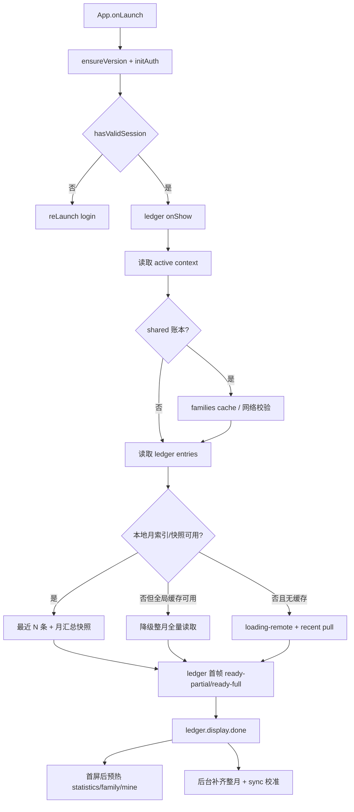
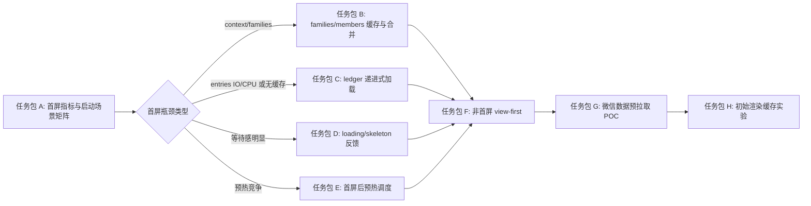

<!--
文档名称: 小程序启动性能优化详细需求与执行安排
文档类型: 需求文档 / 执行计划
版本: v1.0
生成时间: 2026-06-09 19:03:00
需求来源: 启动体验优化专项
关联分析文档: docs/design/miniapp-startup-performance-optimization-analysis.md
关联代码文件:
- miniprogram/app.ts
- miniprogram/app.json
- miniprogram/services/prefetch.ts
- miniprogram/services/db.ts
- miniprogram/services/familyApi.ts
- miniprogram/services/request.ts
- miniprogram/services/syncScheduler.ts
- miniprogram/pages/ledger/index.ts
- miniprogram/pages/ledger/index.wxml
- miniprogram/pages/ledger/index.wxss
- miniprogram/pages/statistics/index.ts
- miniprogram/pages/family/index.ts
- miniprogram/pages/mine/index.ts
- server/src/routes/sync.ts
- server/src/repositories/entryRepo.ts
-->

# 小程序启动性能优化详细需求与执行安排

## 1. 背景

Costra 小程序首屏是 `ledger` 明细页。当前项目已有 `prefetchHomeData()`、分类预热、SWR 缓存、同步调度与 `lazyCodeLoading`，但启动和切页体验仍可能受以下因素影响：

1. 已登录冷启动需要等待 `bootstrapPromise` 后才释放 `ready`。
2. shared 账本需要 `getFamilies()` 校验成员资格，缺少短缓存和 in-flight 合并时会拖慢首屏。
3. 明细页 `listEntries()` 当前从全局 `entry:__index` 逐条读取、过滤、排序，数据量上来后本地 IO 和 JS 计算会影响首屏。
4. 无本地流水缓存时，用户会看到空白或空状态，等待感较强。
5. `statistics`、`family`、`mine` 的预热和 fresh 校准应服从首屏优先，不能抢占 `ledger` 首帧资源。

本需求以“首界面优先、缓存优先、递进式加载、明确加载反馈、任务包独立验收”为原则推进。

## 2. 目标与非目标

### 2.1 目标

| 目标 | 说明 |
|---|---|
| 优先提升首屏 `ledger` 可见速度 | 用户第一眼看到的账本、摘要、流水区域应尽快可用 |
| 覆盖多启动场景 | 已登录/未登录、冷启动/热启动、有缓存/无缓存、shared 校验、弱网/离线、切账号 |
| 本地缓存优先 | 可确认属于当前用户/账本/月的缓存应先展示，再后台校准 |
| 支持递进式流水加载 | 首屏先显示最近 N 条，后台补齐整月 |
| 增加加载反馈 | 数据未就绪时展示 loading/skeleton，不误展示空账本 |
| 降低重复请求 | families/members/context 类请求做短缓存和 in-flight 合并 |
| 逐任务包验收 | 每个任务包可单独上线、回滚、验证收益 |

### 2.2 非目标

| 非目标 | 原因 |
|---|---|
| 不为提速绕过登录态和权限校验 | 防旧用户、旧账本、无权限数据闪现 |
| 不首批预拉取完整流水 | 隐私和体积不可控，微信 pre-fetch 也有 256KB 限制 |
| 不大规模重构 Tab 分包 | 核心 Tab 稳定性优先，收益不确定 |
| 不直接删除 `expense-overlay` | custom tab 中间记账按钮依赖当前页 overlay 实例 |
| 不用最近 N 条冒充整月统计 | partial 数据必须明确标识或用可信月汇总 |

## 3. 用户场景与体验要求

| 场景 | 体验要求 | 数据策略 |
|---|---|---|
| 已登录冷启动，有本地缓存 | 首屏快速显示上次可信内容 | 本地 active context + entries/月快照优先，后台同步 |
| 已登录冷启动，无本地 entries | 不显示空账本，给出等待反馈 | `loading-remote`，远端 recent pull 返回后进入 `ready-partial` |
| shared 账本冷启动 | 不误展示个人账本或无权限数据 | 本地 context + families 短缓存校验；无缓存显示账本验证中 |
| access 过期但 refresh 有效 | 不闪旧数据，恢复后正常展示 | refresh 完成后恢复本地/服务端 preference，再加载缓存 |
| 未登录冷启动 | 不展示任何业务数据 | 保持 `ready=false`，跳登录 |
| 热启动/后台恢复 | 保留现有画面，不全屏 loading | 后台校准，必要时局部更新 |
| 弱网/离线有缓存 | 能看旧数据，提示离线/更新失败 | 本地缓存展示，远端失败静默或轻提示 |
| 弱网/离线无缓存 | 不误空态，有重试入口 | `failed` 状态 + 重试 |
| 冷启动后快速切统计/协作 | 不影响首屏；首屏后再预热 | `ledger.display.done` 后触发非首屏预热 |

## 4. 总体方案

核心调度边界：

- `ready=false`：身份未确认，不展示业务数据。
- `ledger.display.done`：首屏已可见，非首屏预热和较重后台任务的放行点。
- `ready-partial`：最近 N 条已展示，但整月数据或汇总仍在补齐。
- `ready-full`：整月数据与汇总已完成。

## 5. 任务包拆分与执行安排

### 5.1 总执行顺序

### 5.2 执行看板

| 任务包 | 优先级 | 状态 | 依赖 | 是否可独立上线 | 主要产出 |
|---|---|---|---|---|---|
| A 首屏指标与启动场景矩阵 | P0 | Ready | 无 | 是 | 性能日志、场景分类、基线报告 |
| B families/members 缓存与合并 | P0 | Ready | A 可并行观测 | 是 | 短缓存、in-flight 合并、失效点 |
| D loading/skeleton 反馈 | P0 | Ready | A 可并行观测 | 是 | `ledgerLoadingState`、空态保护 |
| E 首屏后预热调度 | P0/P1 | Ready | A 指标判断竞争 | 是 | 非首屏预热延后到首帧后 |
| C ledger 递进式加载 | P1 | Waiting for A | A 指标触发 | 分阶段上线 | 月索引、最近 N 条、后台补齐 |
| F 非首屏 view-first | P1 | Waiting | A/B/E | 是 | statistics/family view cache、切页无闪烁 |
| G 微信数据预拉取 POC | P1/P2 | Waiting | A-F 收益评估 | 灰度 | background fetch token、只读接口 |
| H 初始渲染缓存实验 | P2 | Waiting | A-F | 体验版实验 | 安全壳层缓存验证 |

## 6. 任务包详细需求

### 6.1 任务包 A：首屏指标与启动场景矩阵

#### 目标

建立可量化基线，明确首屏瓶颈来自 bootstrap、context 校验、本地 entries、远端拉取、预热竞争还是 UI 渲染。

#### 功能需求

1. 增加轻量性能记录能力，仅在开发/体验或显式开关下启用。
2. 记录启动链路阶段：
   - `app.launch.start`
   - `app.bootstrap.start`
   - `app.bootstrap.done`
   - `ledger.context.start/done`
   - `ledger.entries.start/done`
   - `ledger.display.done`
   - `prefetch.after-ledger.start/done`
   - `sync.launch.start/done`
3. 记录启动场景标签：
   - `session=logged-in|guest|refreshing`
   - `launch=cold|warm|resume`
   - `ledger=personal|shared|unknown`
   - `entryCache=month-index|snapshot|global-index|none`
   - `network=normal|weak|offline`
   - `dataState=full|partial|empty|unknown`
4. 记录启动后 5 秒内关键网络请求数量和耗时。
5. 输出可复制的调试日志，便于真机测试人员采集。

#### 建议改动文件

| 文件 | 改动 |
|---|---|
| `miniprogram/services/perf.ts` | 新增性能埋点工具 |
| `miniprogram/app.ts` | 记录 launch/bootstrap 阶段 |
| `miniprogram/pages/ledger/index.ts` | 记录 context/entries/display 阶段和缓存状态 |
| `miniprogram/services/prefetch.ts` | 记录预热开始/结束 |
| `miniprogram/services/syncScheduler.ts` | 记录 launch/page-show sync 开始/结束 |

#### 验收标准

- 真机能采集一条完整已登录冷启动日志。
- 能区分有缓存、无缓存、shared、弱网、离线场景。
- 不影响生产包默认行为；关闭开关后无明显额外日志。
- 文档中补充首轮基线数据。

#### 执行安排

- 第 1 个执行。
- 与任务包 B、D 可小范围并行，但 A 的基线必须先产出。

---

### 6.2 任务包 B：families/members 缓存与 in-flight 合并

#### 目标

降低 shared 首屏和 statistics/family 切页时的重复 families/members 网络请求。

#### 功能需求

1. `getFamilies()` 增加 30～60 秒短 TTL 缓存。
2. `getFamilyMembers(familyId)` 增加 30 秒短 TTL 缓存。
3. 同 key in-flight 合并，避免并发重复请求。
4. 提供主动失效方法：
   - `invalidateFamiliesCache()`
   - `invalidateFamilyMembersCache(familyId?)`
5. 在账本/家庭变更路径主动失效：创建、加入、接受邀请、退出、解散、重命名、被移出、画像更新、`SYNC_DONE` 必要路径。

#### 建议改动文件

| 文件 | 改动 |
|---|---|
| `miniprogram/services/familyApi.ts` | 缓存、in-flight、失效 API |
| `miniprogram/services/family.ts` | 账本切换/回退路径按需失效 |
| `miniprogram/pages/ledger/index.ts` | 保持调用语义，受益于缓存 |
| `miniprogram/pages/statistics/index.ts` | 保持调用语义，受益于缓存 |
| `miniprogram/pages/family/index.ts` | 保持调用语义，受益于缓存 |
| `miniprogram/services/family.spec.ts` | 覆盖缓存命中、并发合并、失效 |

#### 验收标准

- 启动后 5 秒内重复 `getFamilies()` 请求减少。
- shared `ledger._loadContext()` 平均耗时下降。
- 创建/加入/退出/解散后缓存不展示旧数据。
- 被移出家庭后不会继续显示无权限账本。

#### 执行安排

- 第 2 个执行。
- 可与任务包 D 并行，但建议先合入 B，降低后续页面状态复杂度。

---

### 6.3 任务包 C：`ledger` 递进式 entries 加载

#### 目标

在本地数据量大或无完整月缓存时，让明细页先显示最近 N 条可见流水，再后台补齐整月数据。

#### 功能需求

1. 新增按 `ledgerId + YYYY-MM` 的本地月索引：
   - key 建议：`entry:index:{ledgerId}:{YYYY-MM}`。
   - 按 `occurred_at desc` 维护。
   - 写入、删除、编辑日期、同步 applyServerChanges 时更新。
2. 新增最近 N 条查询能力：
   - `listRecentEntries({ ledgerId, month, limit })`。
   - 默认 limit 从 20 或 50 开始实验。
3. 新增整月后台补齐能力：
   - 首屏渲染最近 N 条后，后台读取完整月数据。
   - 完成后通过签名 diff 更新 UI，避免无变化二次跳动。
4. 可选月快照：
   - `ledgerMonthSnapshot:{ledgerId}:{YYYY-MM}`。
   - 保存月汇总、最近 N 条 ref、生成时间、active context revision。
5. 无本地 entries 时，支持远端 recent pull：
   - 如果现有 `syncPull` 不能按账本/月/最近 N 条查询，需要新增服务端接口或扩展同步协议。
6. partial UI 约束：
   - 最近 N 条不能冒充整月数据。
   - 顶部汇总只能来自月快照/远端聚合；否则显示“统计更新中”。

#### 建议改动文件

| 文件 | 改动 |
|---|---|
| `miniprogram/services/db.ts` | 月索引、最近 N 条、快照读写、索引迁移/修复 |
| `miniprogram/pages/ledger/index.ts` | `_loadEntries` 拆成 recent 首屏 + full 后台补齐 |
| `miniprogram/pages/ledger/index.wxml` | partial 状态提示 |
| `miniprogram/pages/ledger/index.wxss` | partial/loading 样式 |
| `miniprogram/services/sync.ts` | 评估/扩展 recent pull 参数 |
| `server/src/routes/sync.ts` 或新路由 | 若需要远端 recent 查询，新增只读接口 |
| `server/src/repositories/entryRepo.ts` | 支持按 ledger/month/limit 查询 |
| `miniprogram/services/db.spec.ts` | 索引一致性、recent 查询、编辑日期 |
| `server/test/sync.test.ts` | 若扩展 sync，覆盖 limit/month/ledger |

#### 验收标准

- 1000/5000 条本地 entries 下，最近 N 条首屏显著快于整月全量。
- `ledger.display.done` 在大数据量场景下降。
- partial 阶段不会误导整月汇总。
- 整月补齐后列表、筛选、月份切换、汇总正确。
- 新增、删除、编辑日期、同步拉取、冲突合并后索引无脏数据。

#### 执行安排

- 第 4 个执行，需任务包 A 指标触发。
- 可拆成 C1 本地月索引、C2 最近 N 条 UI、C3 远端 recent pull。

---

### 6.4 任务包 D：loading/skeleton 反馈与空状态保护

#### 目标

数据未就绪时明确提示用户正在加载，避免空白等待或误展示空账本。

#### 功能需求

1. `ledger` 新增 `ledgerLoadingState`：
   - `bootstrapping`
   - `validating-ledger`
   - `loading-cache`
   - `loading-remote`
   - `ready-partial`
   - `ready-full`
   - `empty-confirmed`
   - `failed`
2. `ready=false` 仍作为身份安全门，不展示业务内容。
3. `ready=true` 后，列表区域根据 `ledgerLoadingState` 展示：
   - skeleton 行。
   - “正在同步最近流水…”文案。
   - `failed` 重试入口。
   - partial “统计更新中”。
4. 空状态只在本地和远端都确认无数据后显示。
5. 有旧缓存时不全屏 loading，保留旧内容并展示轻提示。

#### 建议改动文件

| 文件 | 改动 |
|---|---|
| `miniprogram/pages/ledger/index.ts` | 新增状态机与重试事件 |
| `miniprogram/pages/ledger/index.wxml` | skeleton/loading/failed/partial UI |
| `miniprogram/pages/ledger/index.wxss` | 骨架样式和轻提示样式 |
| `miniprogram/pages/ledger/index.json` | 如需引入轻量组件则配置 |

#### 验收标准

- 无缓存弱网不展示空账本。
- loading 与 failed 文案可见，不频繁 toast。
- 有缓存热启动/切回不被全屏 loading 覆盖。
- 未登录冷启动不闪业务壳层。

#### 执行安排

- 第 3 个执行，可与任务包 B 并行。
- 建议先做 D 的状态机，再与 C 的 partial 流程结合。

---

### 6.5 任务包 E：首屏后预热调度

#### 目标

确保非首屏预热和后台校准不抢占 `ledger` 首帧关键路径。

#### 功能需求

1. 定义 `ledger.display.done` 事件或回调。
2. `prefetchHomeData()` / 后续 `prefetchHomeView()` 默认延后到首屏可见后。
3. `syncOnce('launch')` 如被指标证明抢资源，调整为首屏后或低优先级队列。
4. 保留登录成功、热启动、切页触发的降级路径。
5. 所有非首屏预热失败静默，不向首屏传播 loading/toast。

#### 建议改动文件

| 文件 | 改动 |
|---|---|
| `miniprogram/app.ts` | 调整预热触发时机或注册首屏完成回调 |
| `miniprogram/services/prefetch.ts` | 支持首屏后预热队列 |
| `miniprogram/pages/ledger/index.ts` | 首屏完成后通知预热放行 |
| `miniprogram/services/syncScheduler.ts` | 如需要，调整 launch sync 优先级 |

#### 验收标准

- `ledger.display.done` 不因非首屏预热变慢。
- 冷启动后快速切 statistics/family 仍有 cache-first 降级。
- 弱网下非首屏预热失败不影响首屏。

#### 执行安排

- 第 5 个执行。
- 是否调整 `syncOnce('launch')` 需依赖任务包 A 指标。

---

### 6.6 任务包 F：非首屏 view-first 与切页闪烁优化

#### 目标

在首屏稳定后，提升 `statistics`、`family`、`mine` 首次切入和再次切回体验。

#### 功能需求

1. 抽取 `statistics` 月视图纯构建函数。
2. 抽取 `family` summary 视图纯构建函数。
3. `prefetchHomeView()` 在首屏后预构建 view-model。
4. 页面首次进入优先 consume prefetched view，一次 `setData` 完成首帧。
5. fresh 校准结果做 UI 签名 diff，一致时跳过 `setData`。
6. `family` 再次切回：上下文未变时不全屏 loading，只后台 refresh。
7. `mine` overview 可纳入首屏后预热。

#### 建议改动文件

| 文件 | 改动 |
|---|---|
| `miniprogram/pages/statistics/viewModels.ts` | 抽取/补齐纯 view-model 构建 |
| `miniprogram/pages/statistics/index.ts` | consume prefetched view，fresh diff |
| `miniprogram/pages/family/index.ts` | summary view-model、切回无闪烁 |
| `miniprogram/services/prefetch.ts` | `prefetchHomeView` 与 consume API |
| `miniprogram/services/userOverviewApi.ts` | overview 预热接入 |

#### 验收标准

- 首次切 statistics/family 缓存命中时无明显 loading 闪烁。
- 切回 family 不全屏 loading。
- fresh 结果一致时不二次跳动。
- 不影响首屏 `ledger.display.done`。

#### 执行安排

- 第 6 个执行。
- 必须在任务包 E 后，确保 view 预构建只在首屏后执行。

---

### 6.7 任务包 G：微信数据预拉取 POC

#### 目标

验证微信官方数据预拉取能否改善冷启动后首次切 statistics/family/mine 的网络等待。

#### 功能需求

1. 新增专用只读 background fetch token。
2. 登录/续签后调用 `wx.setBackgroundFetchToken({ token })`。
3. 服务端新增预拉取只读接口，支持微信侧 GET。
4. 返回字段白名单，payload 小于 256KB，建议小于 80KB。
5. 小程序启动早期读取 `wx.getBackgroundFetchData({ fetchType: 'pre' })`。
6. 校验 payload user/family/context/revision/TTL 后写入现有缓存。
7. 保留现有 `prefetchHomeData()` 作为降级。

#### 首批数据范围

| 数据 | 是否纳入 | 原因 |
|---|---|---|
| families 精简上下文 | 是 | 首次切页和 shared 校验收益明显 |
| members 精简数据 | 谨慎 | 控制体积，必要字段即可 |
| monthly statistics | 是 | 聚合数据小，适合预拉取 |
| family summary | 是 | 协作页首进收益明显 |
| user overview | 是 | 体积小，只读 |
| 完整 entries | 否 | 隐私和体积不可控 |

#### 建议改动文件

| 文件 | 改动 |
|---|---|
| `miniprogram/services/auth.ts` | 保存/刷新 background fetch token |
| `miniprogram/app.ts` | 启动早期读取 pre-fetch data |
| `miniprogram/services/prefetch.ts` | 解析并注入缓存 |
| `server/src/routes/*` | 新增 prefetch 路由 |
| `server/src/services/*` | token 签发/校验 |
| `server/test/*` | token、TTL、payload size、权限测试 |

#### 验收标准

- 开发者工具可看到微信侧预拉取请求。
- payload size 达标。
- 关闭后台配置、接口失败、payload 过期时现有链路不退化。
- 不复用 access token。

#### 执行安排

- 第 7 个执行。
- 只有 A-F 后仍存在明显非首屏网络等待时进入。

---

### 6.8 任务包 H：初始渲染缓存实验

#### 目标

在首屏数据链路优化后，验证微信初始渲染缓存是否能改善非首次启动壳层速度。

#### 功能需求

1. 仅在体验版实验。
2. 只缓存安全壳层，不缓存敏感流水。
3. 退出登录、切账号、storage version 变化时清理或遮挡旧缓存。
4. 与 `ready` gate 不冲突。

#### 验收标准

- 不闪旧用户敏感数据。
- 非首次启动有明确收益，否则不上线。

#### 执行安排

- 最后执行。
- 若 A-F 收益已满足目标，可不做。

## 7. 里程碑安排

| 里程碑 | 包含任务 | 目标 | 退出条件 |
|---|---|---|---|
| M0 基线与防误导 | A + D | 能测、能反馈、不误空态 | 有完整基线；无缓存不显示空账本 |
| M1 低风险缓存 | B + E | 降低重复请求，确保预热不抢首屏 | repeated requests 下降；首屏不变慢 |
| M2 首屏数据结构 | C | 大数据/无缓存场景首屏可递进显示 | 最近 N 条明显快；整月补齐正确 |
| M3 非首屏体验 | F | 切 statistics/family/mine 更顺滑 | cache/view 命中无明显 loading |
| M4 官方能力 POC | G | 验证微信 pre-fetch 收益 | 灰度 POC 有量化收益 |
| M5 实验项 | H | 验证初始渲染缓存 | 有收益且无安全问题 |

推荐执行顺序：

1. 立即进入 M0：任务包 A + D。
2. M0 完成后进入 M1：任务包 B + E。
3. 根据 A 的指标决定是否立即推进 M2：任务包 C。
4. 首屏稳定后推进 M3：任务包 F。
5. 只有非首屏仍明显等网络时推进 M4：任务包 G。
6. M5 只做体验版实验，不作为主线承诺。

## 8. 验收指标

| 指标 | 验收标准 |
|---|---:|
| 已登录冷启动到 `ledger.display.done` | 先测基线，M1 后目标下降 15% 或不变慢 |
| `ledger.context.done - ledger.context.start` | shared 场景 M1 后下降 |
| `ledger.entries.done - ledger.entries.start` | 1000/5000 条场景 M2 后显著下降 |
| 最近 N 条渲染耗时 | N=20/50 明显低于整月全量 |
| 无缓存到最近流水可见 | loading 后进入 `ready-partial` |
| 空状态误展示 | 0 次 |
| 启动后 5 秒重复 families/members 请求 | M1 后明显下降 |
| statistics/family 首次切入 | cache/view 命中时体感 < 100ms |
| fresh 校准可见跳动 | 无明显跳动 |
| pre-fetch payload size | < 256KB，建议 < 80KB |

## 9. 测试计划

### 9.1 小程序端测试

| 测试组 | 用例 |
|---|---|
| 启动状态 | 未登录、已登录、access 过期 refresh 有效、退出后重启 |
| 账本类型 | personal、shared、有权限、被移出、解散 |
| 缓存状态 | 有 active context、有 entries、无 entries、月索引缺失、快照过期 |
| 网络状态 | 正常、弱网、离线、断网恢复 |
| 数据规模 | 空账本、100 条、1000 条、5000 条 |
| 交互路径 | 冷启动、热启动、后台恢复、快速切 Tab、切月份、切账本 |
| 数据变更 | 新增、编辑金额、编辑日期、删除、同步拉取、冲突合并 |

### 9.2 服务端测试

仅任务包 C/G 涉及服务端时需要：

| 测试组 | 用例 |
|---|---|
| recent pull | ledger/month/limit 查询正确，权限正确 |
| pre-fetch token | 签发、过期、吊销、用户不匹配 |
| payload | 字段白名单、size guard、TTL |
| 权限 | 被移出家庭后不能预拉取旧家庭数据 |

### 9.3 真机验证

- iOS 与 Android 各至少一台。
- 正常网络、弱网、离线各一轮。
- 每个里程碑都记录启动日志和网络请求列表。
- M2 必须覆盖 1000/5000 条本地 entries。

## 10. 回滚与灰度

| 任务包 | 回滚方式 |
|---|---|
| A | 关闭性能日志开关 |
| B | 关闭缓存或设置 TTL=0，保留原请求路径 |
| C | 关闭 recent/month-index 路径，回退 `listEntries()` 全量读取 |
| D | 保留状态字段但 UI 回退旧空状态逻辑 |
| E | 预热恢复当前 fire-and-forget 时机 |
| F | 页面不 consume prefetched view，回退 cache-first |
| G | 后台配置灰度降为 0%，客户端忽略 fetchedData |
| H | 关闭初始渲染缓存实验配置 |

## 11. 当前执行安排

从本需求生成后开始，执行顺序安排如下：

1. **第一批立即执行：M0**
   - 任务包 A：首屏指标与启动场景矩阵。
   - 任务包 D：loading/skeleton 反馈与空状态保护。
2. **第二批：M1**
   - 任务包 B：families/members 缓存与合并。
   - 任务包 E：首屏后预热调度。
3. **第三批：M2**
   - 根据 M0 指标决定是否进入任务包 C。
   - 若 `listEntries()` 或无缓存远端等待成为主要瓶颈，则优先做 C1 本地月索引和 C2 最近 N 条展示。
4. **第四批：M3**
   - 任务包 F：非首屏 view-first 与切页闪烁优化。
5. **后续 POC**
   - 任务包 G/H 只在前序优化收益不足或需要进一步实验时启动。

## 12. 待确认问题

1. 最近 N 条默认值采用 `20` 还是 `50`？建议先用指标同时对比两组。
2. 远端 recent pull 是扩展现有 `syncPull`，还是新增只读 `entries/recent` 接口？建议等 M0/M2 指标证明需要后再决定。
3. partial 阶段顶部汇总是否允许显示“统计更新中”，还是必须提供月汇总快照？建议第一版用“统计更新中”，第二版再补月快照。
4. 性能日志是否需要上报到远端，还是先仅本地 console/调试面板？建议第一版本地即可。

## 13. 实施记录

| 日期 | 里程碑 | 任务包 | 状态 | 变更摘要 | 验证 |
|---|---|---|---|---|---|
| 2026-06-09 | M0 | A 首屏指标与启动场景矩阵 | 已完成 | 新增 `services/perf.ts`；`app.ts` 记录 launch/bootstrap；`request.ts` 统计启动窗口网络请求；`prefetch.ts`、`syncScheduler.ts` 记录预热和同步阶段；`ledger` 记录 context/entries/display、active context、entry cache、data state 等标签 | `npm run typecheck` 通过；`npm test` 119/119 通过 |
| 2026-06-09 | M0 | D loading/skeleton 反馈与空状态保护 | 已完成 | `ledger` 新增 `ledgerLoadingState` 状态机、skeleton/loading/failed/empty-confirmed UI、失败重试；空状态只在 `empty-confirmed` 展示；同账本同月份已有内容时保留旧画面，避免切回全屏 loading | `npm run typecheck` 通过；`npm test` 119/119 通过 |
| 2026-06-09 | M1 | B families/members 缓存与合并 | 已完成 | `familyApi` 新增 `getFamilies()` 60s 短缓存、`getFamilyMembers(familyId)` 30s 短缓存与 in-flight 合并；新增 `invalidateFamiliesCache()`、`invalidateFamilyMembersCache()`；创建/接受邀请/移出/离开/解散/重命名后主动失效；`family.ts` preference 补全/回退路径复用缓存；补充 `familyApi.spec.ts` | `npm run typecheck` 通过；`npm test` 125/125 通过 |
| 2026-06-09 | M1 | E 首屏后预热调度 | 已完成 | 新增 `LEDGER_DISPLAY_READY` 事件；`ledger` 首次 `display.done` 后发事件；`app.ts` 和登录成功路径改为 `scheduleHomeDataPrefetchAfterLedgerReady()`，非首屏 `prefetchHomeData()` 等待首屏完成后触发，避免抢占首屏资源 | `npm run typecheck` 通过；`npm test` 125/125 通过 |
| 2026-06-09 | M2 | C ledger 递进式 entries 加载 | 已完成 | `db.ts` 新增 `entry:index:{ledgerId}:{YYYY-MM}` 月索引、`listMonthEntries()` 最近 N 条查询、索引缺失懒重建；`putEntry/updateEntryFields/deleteEntry/applyServerChanges` 维护索引；`ledger` 首屏读取最近 50 条，若月索引总数超限则进入 `ready-partial` 并显示“统计更新中”，后台补齐整月后签名 diff 更新完整列表和汇总；同步刷新路径改用月索引完整读取 | `npm run typecheck` 通过；`npm test` 130/130 通过 |
| 2026-06-09 | M3 | F 非首屏 view-first 与切页闪烁优化 | 已完成 | `statistics/viewModels.ts` 抽取 `buildMonthlyView()` 纯函数；`prefetch.ts` 在首屏后预热时预构建 monthly view，并纳入 `userOverview` 预热；`statistics` 首次进入优先消费 prefetched monthly view，缓存命中不先写 loading，fresh 结果用签名 diff 跳过无效 setData；`family` 再次切回时若已有同 family/scope summary 则保留旧画面，summary fresh 签名一致时跳过重绘，刷新失败时保留旧数据 | `npm run typecheck` 通过；`npm test` 130/130 通过 |
| 2026-06-09 | M1 | E 预热调度兜底（P0/P1 修复） | 已完成 | **P0**：`prefetch.ts` 的 `scheduleHomeDataPrefetchAfterLedgerReady` 收口为统一 `release` 入口，`LEDGER_DISPLAY_READY` 事件与 3s 兜底定时器「先到先触发」，超时未收到结算信号则直接 `prefetchHomeData()`，避免首屏页非 ledger / 异常路径下预热永久挂起；新增 `__test__` 重置钩子。**P1**：`LEDGER_DISPLAY_READY` 语义升级为「首屏已结算」，payload 增加 `failed`；`ledger` 在 onShow catch、`_loadEntries` 无账本、`_loadContext` 校验失败无法回退、`onRetryLedgerLoad` catch 四处失败分支均经幂等 `_emitLedgerDisplayFailed()` 发结算信号，成功/失败都释放预热。新增 `prefetch.spec.ts`（5 用例）覆盖事件/超时先到先触发、失败态放行、迟到事件幂等、重复调度跳过 | `npm run typecheck` 通过；`npm test` 135/135 通过 |
