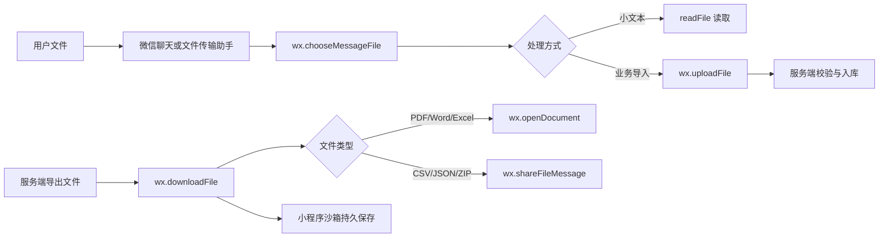
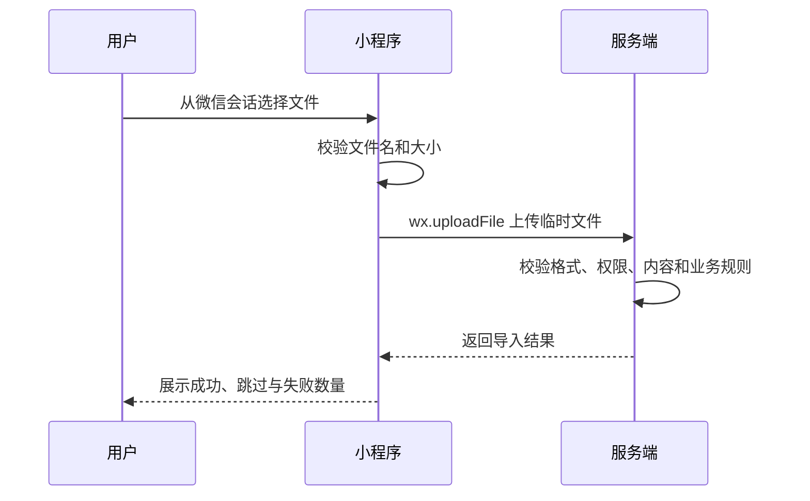

<!--
文档名称: 微信小程序文件导入与导出指南
文档类型: 技术指南
版本: v1.0
生成时间: 2026-07-21 17:33
适用项目: Costra 微信小程序
关联文档: docs/design/data-import-export-client-analysis.md
-->

# 微信小程序文件导入与导出指南

> 本文说明普通微信小程序如何让用户选择并读取文件，以及如何下载、预览、转发或持久保存文件。
>
> 适用基础库：Costra 当前使用 `3.8.12+`，本文涉及的核心 API 均已支持。

## 目录

1. [核心结论](#1-核心结论)
2. [文件系统能力边界](#2-文件系统能力边界)
3. [选择并读取用户文件](#3-选择并读取用户文件)
4. [直接上传用户文件](#4-直接上传用户文件)
5. [下载并交付文件](#5-下载并交付文件)
6. [文件生命周期与存储方式](#6-文件生命周期与存储方式)
7. [限制与安全要求](#7-限制与安全要求)
8. [Costra 推荐方案](#8-costra-推荐方案)
9. [常见问题](#9-常见问题)
10. [官方文档](#10-官方文档)

---

## 1. 核心结论

微信小程序运行在独立文件沙箱中，不能像原生 App 一样任意扫描手机文件系统，也没有浏览器的 `<input type="file">` 和 `<a download>` 能力。

| 用户需求 | 推荐 API | 说明 |
|---|---|---|
| 选择 CSV、JSON 等文件 | `wx.chooseMessageFile` | 从微信客户端会话中选择文件，包括文件传输助手 |
| 读取文本内容 | `FileSystemManager.readFile` | 指定 `encoding: 'utf8'`，返回字符串 |
| 读取二进制内容 | `FileSystemManager.readFile` | 不指定 `encoding`，返回 `ArrayBuffer` |
| 上传文件给服务端 | `wx.uploadFile` | 直接上传临时路径，避免客户端完整读取大文件 |
| 从服务端下载文件 | `wx.downloadFile` | 文件先进入小程序临时目录或指定的用户目录 |
| 预览 PDF、Word、Excel | `wx.openDocument` | 建议设置 `showMenu: true` |
| 把 CSV、JSON、ZIP 交给用户 | `wx.shareFileMessage` | 转发到微信聊天或文件传输助手 |
| 小程序内部持久保存 | `wx.env.USER_DATA_PATH` / `saveFile` | 仅保存在小程序私有沙箱，不等于手机“下载目录” |
| 保存到电脑磁盘 | `wx.saveFileToDisk` | 仅支持 PC 微信 |

推荐流程：



---

## 2. 文件系统能力边界

### 2.1 可以做什么

- 从微信客户端会话中选择文件。
- 从相册选择图片或视频。
- 读取小程序代码包、临时文件、缓存文件和用户文件。
- 下载网络文件到小程序沙箱。
- 将本地文件预览、收藏或转发到微信聊天。
- 在 PC 微信上让用户选择磁盘保存位置。

### 2.2 不能做什么

- 不能任意扫描 Android `/Download` 或 iOS“文件”目录。
- 不能绕过用户操作直接获取其手机文件。
- 不能在手机端直接指定系统下载目录写入任意文件。
- 不能把 `wx.saveFile` 理解为“保存到用户下载目录”；它只保存到小程序私有沙箱。
- 不能依赖临时文件路径跨冷启动长期有效。

---

## 3. 选择并读取用户文件

### 3.1 选择文件

普通微信小程序使用 `wx.chooseMessageFile` 从微信客户端会话选择文件：

```ts
wx.chooseMessageFile({
  count: 1,
  type: 'file',
  extension: ['csv', 'json', 'txt'],
  success(res) {
    const file = res.tempFiles[0]

    console.log({
      name: file.name,
      size: file.size,
      path: file.path,
      type: file.type,
    })
  },
  fail(error) {
    console.error('选择文件失败', error)
  },
})
```

返回的 `file.path` 是小程序可访问的本地临时路径。

`extension` 只用于改善选择体验，不能当作安全校验。文件名、扩展名和客户端声明的类型都可能不可信，服务端仍须验证文件内容。

### 3.2 读取文本文件

CSV、JSON、TXT 等文本文件可以指定 UTF-8 编码：

```ts
const fs = wx.getFileSystemManager()

function readTextFile(filePath: string): void {
  fs.readFile({
    filePath,
    encoding: 'utf8',
    success(res) {
      const content = res.data as string
      console.log('文件内容', content)
    },
    fail(error) {
      console.error('读取文件失败', error)
    },
  })
}
```

如果处理 CSV，还需考虑：

- UTF-8 BOM。
- `CRLF` 与 `LF` 换行。
- 双引号转义。
- 字段中包含逗号或换行。
- 空文件、超长行和异常编码。

不要使用简单的 `line.split(',')` 解析生产 CSV。

### 3.3 读取二进制文件

读取 PDF、Excel、图片等二进制文件时不要传 `encoding`：

```ts
const fs = wx.getFileSystemManager()

fs.readFile({
  filePath,
  success(res) {
    const data = res.data as ArrayBuffer
    console.log('字节数', data.byteLength)
  },
  fail(error) {
    console.error('读取二进制文件失败', error)
  },
})
```

对于需要上传到服务端的大文件，不建议先整体读入内存，应直接把临时路径交给 `wx.uploadFile`。

---

## 4. 直接上传用户文件

典型导入流程：



示例：

```ts
interface SelectedFile {
  name: string
  path: string
  size: number
}

const MAX_IMPORT_BYTES = 5 * 1024 * 1024
const ALLOWED_EXTENSIONS = ['.csv', '.json']

function uploadImportFile(file: SelectedFile, accessToken: string): void {
  const normalizedName = file.name.toLowerCase()
  const extensionAllowed = ALLOWED_EXTENSIONS.some((extension) =>
    normalizedName.endsWith(extension),
  )

  if (!extensionAllowed) {
    wx.showToast({ title: '仅支持 CSV 或 JSON 文件', icon: 'none' })
    return
  }

  if (file.size <= 0 || file.size > MAX_IMPORT_BYTES) {
    wx.showToast({ title: '文件大小必须在 5MB 以内', icon: 'none' })
    return
  }

  wx.uploadFile({
    url: 'https://api.example.com/v1/imports',
    filePath: file.path,
    name: 'file',
    header: {
      Authorization: `Bearer ${accessToken}`,
    },
    success(res) {
      if (res.statusCode < 200 || res.statusCode >= 300) {
        console.error('导入接口返回失败', res.statusCode, res.data)
        return
      }

      const result = JSON.parse(res.data)
      console.log('导入完成', result)
    },
    fail(error) {
      console.error('上传文件失败', error)
    },
  })
}
```

服务端必须重新执行以下校验：

1. 用户身份和目标账本权限。
2. 文件大小、实际格式及编码。
3. CSV 表头或 JSON Schema。
4. 每行字段类型、金额精度和日期范围。
5. 公式注入、重复数据及越权引用。
6. 导入条数、执行时间和请求频率限制。

---

## 5. 下载并交付文件

### 5.1 下载到小程序临时目录

```ts
function downloadFile(url: string): void {
  const task = wx.downloadFile({
    url,
    timeout: 60_000,
    success(res) {
      if (res.statusCode !== 200) {
        wx.showToast({ title: '下载失败', icon: 'none' })
        return
      }

      console.log('临时文件路径', res.tempFilePath)
    },
    fail(error) {
      console.error('下载失败', error)
    },
  })

  task.onProgressUpdate(({ progress }) => {
    console.log(`下载进度：${progress}%`)
  })
}
```

`wx.downloadFile` 只要收到服务器响应，就可能进入 `success` 回调，因此业务代码必须检查 `statusCode`，不能把进入 `success` 等同于文件下载成功。

服务端应返回正确的 `Content-Type`。正式环境下载地址必须为 HTTPS，并配置在小程序后台的“下载合法域名”中。

### 5.2 预览 PDF、Word 或 Excel

```ts
wx.downloadFile({
  url: 'https://download.example.com/report.pdf',
  success(res) {
    if (res.statusCode !== 200) return

    wx.openDocument({
      filePath: res.tempFilePath,
      fileType: 'pdf',
      showMenu: true,
      fail(error) {
        console.error('打开文档失败', error)
      },
    })
  },
})
```

`wx.openDocument` 支持 `doc`、`docx`、`xls`、`xlsx`、`ppt`、`pptx` 和 `pdf`。CSV、JSON、ZIP 不属于其标准预览类型。

微信客户端 `7.0.12` 之后默认不显示右上角菜单；需要用户保存、收藏或转发时，应主动设置 `showMenu: true`。

### 5.3 转发 CSV、JSON 或 ZIP

```ts
wx.downloadFile({
  url: 'https://download.example.com/export.csv',
  success(res) {
    if (res.statusCode !== 200) return

    wx.shareFileMessage({
      filePath: res.tempFilePath,
      fileName: 'Costra-账单导出.csv',
      fail(error) {
        console.error('转发文件失败', error)
      },
    })
  },
})
```

这是手机端把通用文件真正交付给用户的推荐方式。用户可以发送到文件传输助手，再在手机或电脑中保存和处理。

### 5.4 保存到 PC 磁盘

```ts
wx.saveFileToDisk({
  filePath: localFilePath,
  fail(error) {
    console.error('保存到磁盘失败', error)
  },
})
```

`wx.saveFileToDisk` 仅支持 PC 微信，不可作为手机端通用下载方案。

---

## 6. 文件生命周期与存储方式

### 6.1 临时文件

由 `wx.chooseMessageFile`、`wx.downloadFile` 等接口产生。临时文件仅在当前生命周期内保证有效，冷启动后不保证存在。

适用场景：

- 选完立即上传。
- 下载完立即预览或转发。
- 无须下次启动继续使用。

### 6.2 本地缓存文件

可以通过 `FileSystemManager.saveFile` 把临时文件转为缓存文件：

```ts
const fs = wx.getFileSystemManager()

fs.saveFile({
  tempFilePath,
  success(res) {
    console.log('缓存文件路径', res.savedFilePath)
  },
})
```

`saveFile` 成功后会移动临时文件，原 `tempFilePath` 不再可用。

### 6.3 本地用户文件

需要可控文件名和目录时，使用 `wx.env.USER_DATA_PATH`：

```ts
const targetPath = `${wx.env.USER_DATA_PATH}/costra-export.csv`

wx.downloadFile({
  url: downloadUrl,
  filePath: targetPath,
  success(res) {
    if (res.statusCode === 200) {
      console.log('用户文件路径', res.filePath)
    }
  },
})
```

本地缓存文件与本地用户文件共享小程序存储空间，最多共计 200MB。它们仍属于小程序私有沙箱，不会自动出现在手机系统下载目录。

---

## 7. 限制与安全要求

### 7.1 平台限制

| 能力 | 限制 |
|---|---|
| `wx.chooseMessageFile` | 基础库 `2.5.0+`；从客户端会话选择文件 |
| `FileSystemManager.readFile` | 单个文件上限 100MB |
| `wx.downloadFile` | 单次下载文件最大 200MB |
| `wx.openDocument.showMenu` | 基础库 `2.11.0+` |
| `wx.shareFileMessage` | 基础库 `2.16.1+` |
| 本地缓存文件 + 用户文件 | 每个小程序共计最多 200MB |
| `wx.saveFileToDisk` | 仅 PC 微信支持 |

### 7.2 网络要求

- 下载接口应使用 HTTPS。
- 下载域名必须配置为小程序“下载合法域名”。
- 上传域名必须配置为“上传合法域名”。
- HTTPS 证书和 TLS 版本必须符合微信要求。
- 开发者工具中的“不校验合法域名”只适用于开发调试，正式版本仍会校验。

### 7.3 安全要求

- 客户端扩展名过滤不能替代服务端格式校验。
- 不要信任文件名、MIME、CSV 表头或 JSON 字段。
- 导入文件必须在服务端执行权限校验和事务处理。
- 导出链接应设置短有效期、用户绑定和使用次数限制。
- 文件名应移除 `/`、`\\`、`:`、`*` 等非法或危险字符。
- CSV 导出应防范公式注入；以 `=`、`+`、`-`、`@` 开头的用户文本需要安全转义。
- 下载完成后应校验 HTTP 状态码；高安全场景可进一步校验文件摘要。

---

## 8. Costra 推荐方案

### 8.1 导入

```text
用户把 CSV 发到文件传输助手
  → 小程序 wx.chooseMessageFile
  → 客户端检查后缀与大小
  → wx.uploadFile 上传
  → 服务端统一解析、权限校验、去重并事务入库
  → 返回结构化导入报告
```

客户端不承担完整 CSV 解析和业务校验，避免前后端维护两套导入规则。

### 8.2 导出

```text
小程序提交导出条件
  → 服务端生成 CSV
  → 返回短时效下载地址
  → 小程序 wx.downloadFile
  → wx.shareFileMessage 转发文件传输助手
```

如果导出的是 PDF、Word 或 Excel，可以额外提供 `wx.openDocument({ showMenu: true })` 预览入口。

### 8.3 建议交互

导入按钮旁明确提示：

> 请先把 CSV 文件发送到微信“文件传输助手”，再点击选择文件。

导出完成后提供操作面板：

1. 发送到微信。
2. 预览文件（仅支持的文档类型）。
3. 取消。

不要把“保存到小程序沙箱”包装成“已下载到手机”，否则会造成用户误解。

---

## 9. 常见问题

### 9.1 能否直接读取手机“下载”目录？

不能。普通微信小程序没有任意读取手机文件系统的权限。通用文件应先发送到微信会话或文件传输助手，再通过 `wx.chooseMessageFile` 选择。

### 9.2 `wx.saveFile` 是否会把文件保存到手机？

不会。它只把临时文件移动到小程序私有缓存区，其他 App 和系统文件管理器通常不能直接访问。

### 9.3 为什么下载接口进入 `success`，得到的却不是文件？

`wx.downloadFile` 收到 HTTP 错误响应时也可能写入响应体并进入 `success`。必须检查 `res.statusCode`，同时确保服务端返回正确的 `Content-Type`。

### 9.4 CSV 为什么不直接调用 `wx.openDocument`？

`wx.openDocument` 的标准支持类型不包括 CSV。CSV 更适合通过 `wx.shareFileMessage` 发送到文件传输助手，再由 Excel、WPS 或 Numbers 打开。

### 9.5 大文件是否应该先 `readFile` 再上传？

不应该。整体读取会增加内存占用，而且 `readFile` 有单文件 100MB 上限。上传场景应直接使用 `wx.uploadFile` 读取临时路径。

---

## 10. 官方文档

- [`wx.chooseMessageFile`](https://developers.weixin.qq.com/miniprogram/dev/api/media/image/wx.chooseMessageFile.html)
- [`FileSystemManager`](https://developers.weixin.qq.com/miniprogram/dev/api/file/FileSystemManager.html)
- [`FileSystemManager.readFile`](https://developers.weixin.qq.com/miniprogram/dev/api/file/FileSystemManager.readFile.html)
- [`wx.uploadFile`](https://developers.weixin.qq.com/miniprogram/dev/api/network/upload/wx.uploadFile.html)
- [`wx.downloadFile`](https://developers.weixin.qq.com/miniprogram/dev/api/network/download/wx.downloadFile.html)
- [`wx.openDocument`](https://developers.weixin.qq.com/miniprogram/dev/api/file/wx.openDocument.html)
- [`wx.shareFileMessage`](https://developers.weixin.qq.com/miniprogram/dev/api/share/wx.shareFileMessage.html)
- [`wx.saveFileToDisk`](https://developers.weixin.qq.com/miniprogram/dev/api/file/wx.saveFileToDisk.html)
- [微信小程序文件系统](https://developers.weixin.qq.com/miniprogram/dev/framework/ability/file-system.html)

---

## 变更记录

| 版本 | 日期 | 变更内容 |
|---|---|---|
| v1.0 | 2026-07-21 | 初始版本：整理文件选择、读取、上传、下载、预览、转发与存储方案 |
