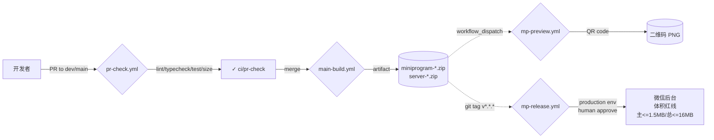

# Costra · CI/CD 总览（占位阶段）

> Refs: COSTRA-040, charter §9（外部资源）, ADR-0004 §2（分包/体积/灰度）

本轮为**占位交付**：跑通 lint/typecheck/test/build，上传小程序动作在 robot key 缺失时优雅短路。资源到位后按 §激活清单 1-5 步即可激活真实链路。

---

## 1. 架构图



## 2. 触发矩阵

| Workflow | 触发 | 需 Secret | 占位可跑 |
|---|---|---|---|
| `pr-check.yml` | `pull_request` | ❌ | ✅ |
| `main-build.yml` | `push` to main/dev | ❌ | ✅ |
| `mp-preview.yml` | `workflow_dispatch` | `MP_CI_KEY_STAGING` + `MP_APPID_STAGING` | ✅（缺 key 自动 skip） |
| `mp-release.yml` | `push` tag `v*.*.*` + `production` env approve | `MP_CI_KEY_PROD` + `MP_APPID` | ✅（缺 key 自动 skip） |

## 3. 失败兜底

- `pr-check` 红：禁止合并（分支保护规则强制 `ci/pr-check` 必须通过）
- `main-build` 红：保留 artifact 便于调试；回滚由 Human 在 GitHub Settings 操作，CI 不介入（Sprint-1 再做 auto-revert）
- `mp-release` 体积超标：直接 fail，不产生实际上传（`upload.mjs` 内置红线校验）
- 小程序灰度回滚：微信公众平台 → 版本管理 → "回滚到历史版本"（与 CI 解耦）

## 4. 激活清单（从占位 → 真实链路）

> 预计耗时：30 分钟（有全部资源的情况下）

### Step 1 · 补齐外部资源
- [ ] 申请体验版 AppID（若 ≠ 生产 `wxf8b0d3e3a83f9941`）
- [ ] 微信公众平台 → 开发管理 → 开发设置 → **小程序代码上传** → 生成 robot key（分 staging / prod 两把）
- [ ] 企业主体认证、备案域名 + HTTPS 证书（后端接入时需要）
- [ ] 订阅消息模板 ID ×3（对齐 ADR-0004 §5）

### Step 2 · GitHub 仓库配置
- [ ] Settings → Secrets and variables → Actions → **Secrets**
  - `MP_CI_KEY_STAGING` = 体验版 robot key pem 内容
  - `MP_CI_KEY_PROD` = 生产 robot key pem 内容
- [ ] Settings → Secrets and variables → Actions → **Variables**
  - `MP_APPID` = `wxf8b0d3e3a83f9941`
  - `MP_APPID_STAGING` = `<体验版 AppID>`
  - `SERVER_API_BASE_STAGING` / `SERVER_API_BASE_PROD`

### Step 3 · GitHub Environment
- [ ] Settings → Environments → 新建 `production`
  - Required reviewers：至少 1 人（上线决策人）
  - Deployment branch：仅 `main`

### Step 4 · 分支保护
- 按 `docs/devops/branch-protection.md` 配置 `main` / `dev`

### Step 5 · 安装依赖并验证
```bash
npm i -D miniprogram-ci
# 在 dev 分支打一个 PR，观察 pr-check 全绿
# 手动触发 mp-preview.yml（从 dev 分支）→ 应能产出预览二维码
# 打 tag v0.1.0-alpha 在 main → 应触发 mp-release.yml 并要求审批
```

## 5. 故障排查 FAQ

**Q1：pr-check 报 `npm ci` 失败**  
A：清本地 `node_modules` 后 `npm install` 生成 lockfile 再提交（首次接入）。

**Q2：`mp:build:check` size-check 报主包超标**  
A：检查 `miniprogram/components/` 是否引入了大图；图片资源应走 CDN 而非打包。

**Q3：`mp-preview` 产出二维码但无法扫码**  
A：检查 AppID 是否为体验版，且账号是否在"体验者名单"。

**Q4：`mp-release` 在 production env 一直卡住**  
A：去 Actions → 对应 run → review pending deployments → Approve。

**Q5：tag 打错了想重跑**  
A：删 tag + 重打：`git tag -d vX.Y.Z && git push origin :refs/tags/vX.Y.Z`，然后 `git tag vX.Y.Z && git push origin vX.Y.Z`。

## 6. 关键约束

- **永不提交真实密钥**：所有 `*.key`、`.env`、`.env.local` 已在 `.gitignore`
- **Fork PR 拿不到 secret**：`mp-preview.yml` 已内置 `if: github.event.pull_request.head.repo.full_name == github.repository`，外部贡献者 PR 会 skip
- **Node / npm 版本锁**：CI 使用 `20.12.2`，本地建议通过 `.nvmrc`（Sprint-1 补）
- **Conventional Commits**：PR 标题会被 `commitlint` 校验，类型限于 `feat/fix/chore/refactor/docs/test/build/ci/perf`，scope 限于 `miniapp/backend/design/devops/qa/docs/api/db/repo`
