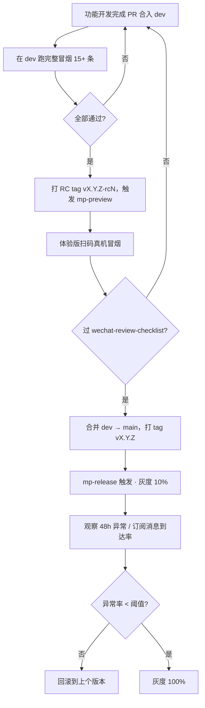

# Costra · 测试策略 v0.1

> Refs: COSTRA-050, PRD Epic-A~G AC, ADR-0004, `.team/engineering-guidelines.md`  
> 版本：v0.1（Sprint-0 基线）  
> 更新时机：每个 Sprint 末尾随 retrospective 迭代

---

## 1. 指导原则

1. **测试左移**：每个 Story 的 PR 必须自带单元 / 集成用例；冒烟在每次发布前必跑
2. **分层测试金字塔**：单元 70% / 集成 20% / E2E 10%
3. **契约先行**：OpenAPI（`docs/api/`）是前后端的唯一真源，集成测试围绕契约断言
4. **自动化优先**：手工测试仅用于不可自动化场景（真机、审核前自查）
5. **失败即阻塞**：PR 的 `ci/pr-check` 红即禁止合入（由 DevOps 的分支保护强制）

---

## 2. 分层策略

### 2.1 单元测试

**覆盖对象**：`miniprogram/services/**` `miniprogram/utils/**` `server/src/**`（business / utils / validators）  
**工具**：
- MiniApp 侧：**Jest** + `miniprogram-simulate`（模拟 `wx.*` API）
- Server 侧：**Vitest**（更快，ESM 友好）+ `supertest`

**覆盖率门槛**（Sprint-1 起生效）：
- 业务逻辑 / 工具：≥ **70%** lines + branches
- 页面 `.ts` 控制层：≥ 40%（UI 交互留给 E2E）
- `any`、`@ts-ignore` 占比 ≤ 2%（ESLint 统计）

### 2.2 集成测试

**覆盖对象**：API 契约 + DB + 幂等 + 冲突合并  
**工具**：
- `supertest`（HTTP 层）+ `pg-test`（临时 Postgres schema 隔离）+ OpenAPI schema 断言（`jest-openapi`）
- 每个 P0 接口：200 正常流 + 至少 2 个错误码路径（401/403/409/422）

**特别验证**：
- `POST /v1/ledger/entries` 的 `Idempotency-Key` 幂等（重放返回同一资源）
- `POST /v1/sync/push` 的 Last-Writer-Wins + `updatedAt` 冲突策略（对照 `docs/api/conflict-strategy.md`）
- 金额以分（int）存传，边界 `INT_MAX / 100`、负数、小数截断

### 2.3 E2E 测试

**覆盖对象**：跨页面用户旅程 + 关键可见行为  
**工具**：
- `miniprogram-automator`（腾讯官方 · [docs](https://developers.weixin.qq.com/miniprogram/dev/devtools/auto/)）
- 真机：本地接个 Android/iOS 手机跑冒烟（仅发版前）

**覆盖项**（Sprint-1 起增量上线）：
- 登录闭环（`pages/login` → `home`）
- 记一笔全流程（`home` → `entry` → `home` 列表刷新）
- 家庭邀请（分享卡片 → 扫码入家）
- 订阅消息授权（首次 `requestSubscribeMessage` 弹窗 → 拒绝 → 再次提示逻辑）

### 2.4 非功能测试

| 类型 | 工具 | 指标 |
|---|---|---|
| 性能（前端） | WeChat DevTools Performance + `miniprogram-automator` | 冷启 TTI ≤ 2s；首屏 LCP ≤ 2.5s |
| 性能（后端） | **k6** | P95 ≤ 300ms @ 100 QPS；错误率 < 0.5% |
| 安全 | **OWASP ZAP** 被动扫描 + 手动 OAuth/CSRF 检查 | 无 Critical/High |
| 兼容 | 真机矩阵：iOS 14+ / Android 8+，微信近 1 年版本 | 基础库 ≥ 2.32.3 |
| 合规 | `docs/qa/wechat-review-checklist.md` | 发版前全部 ✅ |

---

## 3. PR QA Gate 模板

> 在 PR 描述中粘贴下列模板；审查人勾选。`ci/pr-check` 必须全绿（DevOps 已固定 status check 名）。

```markdown
## QA Gate

### 代码层
- [ ] 新增业务逻辑有单测覆盖，`npm test` 本地通过
- [ ] 契约变更已同步 `docs/api/openapi.yaml` 并通过 schema 断言
- [ ] 无新增 `any` / `@ts-ignore`（或已在 PR 说明中豁免）

### 行为层（勾选适用项）
- [ ] 冒烟用例（`docs/qa/smoke-cases.md`）已本地过一遍
- [ ] 真机验证（iOS + Android 各 1 台）
- [ ] 性能：冷启 TTI ≤ 2s 仍满足（若动了主包/首屏）
- [ ] 兼容：基础库 2.32.3 + 最新两个微信版本无异常

### 合规层（涉及微信审核时勾选）
- [ ] `docs/qa/wechat-review-checklist.md` 相关条目已复核
- [ ] 新增用户信息收集已在隐私指引登记

### CI
- [ ] `ci/pr-check` 全绿（lint / typecheck / test / size）
```

---

## 4. 发布前完整 QA 流程（Sprint-1 起启用）



---

## 5. 缺陷分级

| 级别 | 定义 | 响应 | 举例 |
|---|---|---|---|
| **P0 / Blocker** | 核心闭环不可用 / 数据丢失 / 隐私泄漏 | 立即回滚 + 热修 | 无法登录；金额存负；Token 明文上报 |
| **P1 / Critical** | 主路径异常但有 workaround | 当 Sprint 必修 | 家庭邀请码无法识别；冷启 > 3s |
| **P2 / Major** | 次要功能或非关键 UX | 下一 Sprint | 统计页面图例颜色与 token 不一致 |
| **P3 / Minor** | 文案 / 小瑕疵 | 积压，有人接就修 | 空态插图错位 1px |

---

## 6. 工具链总览

| 角色 | 工具 | 落地位置 |
|---|---|---|
| 单测（miniapp） | Jest + `miniprogram-simulate` | `miniprogram/**/__tests__/` |
| 单测（server） | Vitest | `server/**/*.spec.ts` |
| 集成 | supertest + jest-openapi + pg-test | `server/tests/integration/` |
| E2E | miniprogram-automator | `qa/e2e/` |
| 性能（后端） | k6 | `qa/perf/*.js` |
| 性能（前端） | DevTools Performance + 自动化脚本 | 手工 + `qa/e2e/perf.spec.mjs` |
| 安全 | OWASP ZAP（被动） | `qa/security/` |
| 契约断言 | jest-openapi + spectral | PR 级 lint |

> 注：Sprint-0 仅定策略与目录占位，Sprint-1 开始按卡号落实际脚本。

---

## 7. 与 DevOps / Backend / MiniApp / Design 的握手

| 对手 | 握手点 |
|---|---|
| **DevOps** | PR status check 名固定 `ci/pr-check`，本文档与 `.github/workflows/pr-check.yml` 对齐 |
| **Backend** | OpenAPI = 契约单一真源；集成测试直接跑 `docs/api/conflict-strategy.md` 的矩阵 |
| **MiniApp** | `miniprogram/services/*` 必须可单测（stub `wx.*`） |
| **Design** | 视觉回归暂缓，Sprint-2 评估引入 Chromatic / Applitools |

---

## 8. 风险与对策

| 风险 | 对策 |
|---|---|
| 真机资源不足 | 在 Sprint-1 前建立 BYO 真机池（核心开发人员各提供 1 台 iOS/Android） |
| 订阅消息到达率难量化 | 后端埋 `subscribe_msg_sent_total` / `delivered_total`（Prometheus），QA 只消费，不搭建 |
| 微信基础库版本飘移 | CI 每周跑一次"最新基础库"兼容冒烟（Sprint-2 自动化） |
| E2E 脆弱 | 用 `page.waitFor('data-loaded')` 替代 sleep；失败自动截图归档 |
